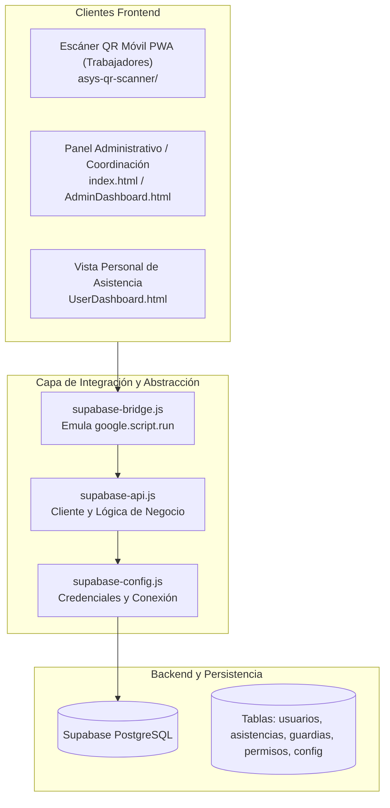

# DOCUMENTACIÓN MAESTRA Y ARQUITECTURA TÉCNICA
## SISTEMA DE CONTROL DE ASISTENCIA Y SEGURIDAD INSTITUCIONAL (ASIS)

**Entidades Oficiales:**
* **Ministerio del Poder Popular para Hábitat y Vivienda (MINVH)**
* **Constructora del Alba Bolivariana C.A.** (RIF: G-200170344)

---

## 1. INTRODUCCIÓN Y PROPÓSITO DEL DOCUMENTO

Este documento constituye la **especificación técnica, funcional y arquitectónica definitiva** del Sistema ASIS (versión 1.0 / 2.0). Su objetivo es proporcionar a los equipos de desarrollo, arquitectura y soporte técnico toda la información crítica para comprender el diseño actual, desplegar réplicas independientes (forks / clones) y extender el sistema con nuevos módulos y funcionalidades operativas sin comprometer la estabilidad ni la seguridad.

---

## 2. FICHA TÉCNICA DEL PROYECTO

| Parámetro | Detalle |
| :--- | :--- |
| **Nombre del Sistema** | Sistema ASIS (Asistencia y Seguridad Institucional) |
| **Organizaciones** | Ministerio del Poder Popular para Hábitat y Vivienda / Constructora del Alba Bolivariana C.A. |
| **Arquitectura de Software** | Híbrida: Single Page Application (SPA) desacoplada con Backend como Servicio (BaaS) en Supabase + Compatibilidad Legacy en Google Apps Script |
| **Base de Datos** | PostgreSQL 15+ gestionado en Supabase |
| **Frontend Web** | HTML5 semántico, CSS3 nativo, JavaScript ECMAScript 2021+, Bootstrap 4.6, DataTables 1.13, FontAwesome 5.15 |
| **Módulo Móvil PWA** | Escáner QR PWA (`asys-qr-scanner/`) con Service Worker, Web Workers y HTML5-QRCode |
| **Seguridad de Acceso** | SHA-256 con Salt aleatorio de 16 caracteres, vinculo único de dispositivo (Anti-Fraud) |
| **Exportaciones** | Sábana Semanal de Asistencia en Formato Excel (.xlsx) horizontal con SheetJS / ExcelJS y reportes PDF |
| **Control de Versiones** | Git / GitHub: `https://github.com/Dobran98/System-Asis-V1.git` (Rama: `main`) |

---

## 3. ARQUITECTURA GENERAL DEL SISTEMA

El sistema opera bajo un patrón desacoplado y reactivo diseñado para funcionar tanto en la nube moderna (Vercel, GitHub Pages, Netlify, servidores propios) como en el entorno institucional tradicional de Google Apps Script:



### Componentes de la Arquitectura:

1. **`index.html` (Shell SPA):** Contenedor principal para despliegue web independiente. Inyecta dinámicamente las vistas (`LoginPage.html`, `AdminDashboard.html`, `CoordinadorDashboard.html`, `UserDashboard.html`) según la sesión del usuario.
2. **`js/supabase-config.js`:** Centraliza las variables de conexión a la nube (`SUPABASE_URL` y `SUPABASE_ANON_KEY`) e inicializa el cliente oficial `window.supabaseClient`.
3. **`js/supabase-api.js`:** Es el **núcleo de lógica de negocio**. Reemplaza y supera las antiguas funciones de servidor de Google Apps Script, ejecutando consultas asíncronas, cálculos de horas, validaciones de seguridad, hash de contraseñas y transacciones directas sobre PostgreSQL.
4. **`js/supabase-bridge.js`:** Proxy transparente que intercepta todas las llamadas a `google.script.run` en los scripts de interfaz y las redirige fluidamente a `asisApi` con promesas de resolución (`withSuccessHandler` y `withFailureHandler`). Esto garantiza **cero fricción** al migrar o compartir código entre Apps Script y Web pura.
5. **`js/legacy-app.js` / `JavaScript.html`:** Manejador de eventos del DOM, configuración de DataTables, modales interactivos, filtros dinámicos y renderizado de componentes.
6. **`asys-qr-scanner/`:** Módulo Progressive Web App (PWA) instalable en teléfonos Android e iOS para escanear credenciales QR y transmitir asistencias con geolocalización y huella de hardware.

---

## 4. MODELO DE DATOS Y ESQUEMA POSTGRESQL (SUPABASE)

El sistema se apoya en 8 tablas relacionales estructuradas en PostgreSQL. A continuación se detalla el diccionario de datos esencial:

### 4.1. Tabla: `usuarios`
Almacena el censo completo de personal, credenciales, estado y vinculación de equipos.

| Columna | Tipo | Restricción | Descripción |
| :--- | :--- | :--- | :--- |
| `user_id` | TEXT / VARCHAR | PRIMARY KEY | Identificador único del usuario (ej. `user001`, `user_1793092331019`) |
| `nombre` | TEXT | NOT NULL | Nombre y Apellido completos del trabajador |
| `primer_nombre` | TEXT | INDEXADO | Primer nombre normalizado en minúsculas para inicio de sesión rápido (ej. `brando`) |
| `email` | TEXT | NULLABLE | Correo electrónico institucional o personal |
| `password_hash` | TEXT | NOT NULL | Contraseña almacenada en formato seguro `salt:hashHex` |
| `rol` | TEXT | NOT NULL | Rol principal: `Admin`, `Coordinador`, `Usuario` |
| `sub_rol` | TEXT | DEFAULT 'Operador/a' | Sub-rol operativo: `SuperAdmin`, `Coordinador General`, `Operador/a` |
| `cedula` | TEXT | NULLABLE | Documento de identidad nacional (formato: `V-12345678`, `E-12345678` o número simple) |
| `institucion` | TEXT | DEFAULT 'Sede Central' | Centro de trabajo o sede operativa asignada |
| `turno` | TEXT | DEFAULT 'mañana' | Turno principal de trabajo: `mañana`, `tarde`, `nocturno` |
| `nacimiento` | DATE / TIMESTAMPTZ | NULLABLE | Fecha de nacimiento para expedientes |
| `estado` | TEXT | DEFAULT 'Activo' | Condición administrativa: `Activo` o `Inactivo` |
| `foto_url` | TEXT | NULLABLE | Enlace o Base64 de la fotografía del trabajador |
| `telefono` | TEXT | NULLABLE | Número telefónico de contacto |
| `direccion` | TEXT | NULLABLE | Dirección domiciliaria |
| `fecha_inclusion`| DATE / TIMESTAMPTZ | DEFAULT NOW() | Fecha de ingreso institucional |
| `areas_ids` | JSONB / TEXT[] | NULLABLE | Arreglo de identificadores de áreas a las que tiene acceso o supervisa |
| `dispositivo_vinculado_id` | TEXT | NULLABLE | Huella digital de hardware del único dispositivo autorizado para marcar |
| `dispositivo_info` | TEXT | NULLABLE | Marca, modelo, navegador o sistema operativo del dispositivo registrado |
| `dispositivo_fecha_vinculacion` | TIMESTAMPTZ | NULLABLE | Fecha y hora exacta de vinculación del equipo |

### 4.2. Tabla: `asistencias`
Bitácora inmutable de entradas y salidas registradas.

| Columna | Tipo | Restricción | Descripción |
| :--- | :--- | :--- | :--- |
| `id` | BIGSERIAL / UUID | PRIMARY KEY | Identificador único del registro |
| `user_id` | TEXT | REFERENCES usuarios(user_id) | Identificador del trabajador que marca |
| `nombre` | TEXT | NOT NULL | Nombre del trabajador al momento de la marca |
| `turno` | TEXT | NOT NULL | Turno en el que labora (`mañana`, `tarde`, `nocturno`) |
| `institucion` | TEXT | NOT NULL | Sede o proyecto donde se registra la asistencia |
| `tipo` | TEXT | NOT NULL | Tipo de marcaje: `Entrada` o `Salida` |
| `estado` | TEXT | DEFAULT 'Presente' | `Presente`, `Retardo`, `Fuera de Rango` |
| `latitud` | NUMERIC | NULLABLE | Coordenada GPS de latitud de la marca |
| `longitud` | NUMERIC | NULLABLE | Coordenada GPS de longitud de la marca |
| `timestamp` | TIMESTAMPTZ | DEFAULT NOW() | Estampa cronológica precisa del marcaje |
| `dispositivo_id` | TEXT | NULLABLE | ID del dispositivo físico que originó el marcaje |
| `dispositivo_info`| TEXT | NULLABLE | Descripción del navegador o hardware emisor |
| `notas` | TEXT | NULLABLE | Observaciones adicionales del marcaje |

### 4.3. Tabla: `guardias`
Planificación y asignación de guardias diurnas, nocturnas y de fin de semana.

| Columna | Tipo | Descripción |
| :--- | :--- | :--- |
| `id` | BIGSERIAL / UUID | Identificador de la guardia |
| `user_id` | TEXT | Trabajador asignado |
| `nombre_usuario` | TEXT | Nombre del trabajador |
| `fecha_guardia` | DATE | Fecha en formato `YYYY-MM-DD` |
| `turno` | TEXT | `nocturno`, `diurno`, `fin_de_semana` |
| `horas_estimadas` | INTEGER | Horas programadas a cumplir (ej. 12 horas) |
| `estado` | TEXT | `Programada`, `Cumplida`, `Cancelada` |
| `notas` | TEXT | Detalles de la orden de guardia |

### 4.4. Tabla: `permisos`
Justificaciones, reposos y permisos laborales aprobados.

| Columna | Tipo | Descripción |
| :--- | :--- | :--- |
| `id` | BIGSERIAL / UUID | Identificador del permiso |
| `user_id` | TEXT | Trabajador solicitante |
| `tipo` | TEXT | `Médico`, `Personal`, `Duelo`, `Comisión de Servicio` |
| `fecha_inicio` | TIMESTAMPTZ | Inicio del periodo justificado |
| `fecha_fin` | TIMESTAMPTZ | Fin del periodo justificado |
| `motivo` | TEXT | Explicación detallada |
| `estado` | TEXT | `Pendiente`, `Aprobado`, `Rechazado` |
| `aprobado_por` | TEXT | Usuario directivo que autorizó el permiso |

### 4.5. Tablas Auxiliares:
* **`areas_trabajo`:** Áreas operativas (`area_id`, `nombre_area`, `estado`).
* **`config_horarios`:** Parametrización de horas límite y tolerancias por turno.
* **`solicitudes_manuales`:** Justificación de olvido de marcaje solicitada por el personal.
* **`auditoria`:** Registro inmutable de acciones críticas realizadas por administradores.

---

## 5. MECANISMOS DE SEGURIDAD Y VALIDACIONES CRÍTICAS

### 5.1. Autenticación Tolerante (Primer Nombre o Cédula)
Para evitar que el personal olvide credenciales complejas o correos extensos, el sistema implementa búsqueda inteligente en `asisApi.userLogin()`:
* **Búsqueda por Primer Nombre:** Si ingresa `brando`, el sistema busca usuarios cuyo primer nombre o inicio de nombre coincida.
* **Búsqueda por Cédula:** Acepta formatos como `V-12345678`, `E-12345678` o simplemente `12345678`.
* **Compatibilidad:** Mantiene soporte para ingreso con correo institucional o `user_id`.

### 5.2. Blindaje Criptográfico de Contraseñas (SHA-256 + Salt)
* **Formato:** `salt:hashHex` (16 caracteres hexadecimales aleatorios + 64 caracteres de hash SHA-256).
* **Auto-blindaje transparente:** Si un usuario antiguo aún tiene su contraseña en texto plano en la base de datos, el sistema verifica la coincidencia, genera inmediatamente el Salt criptográfico y actualiza el campo en Supabase de forma totalmente invisible para el usuario.
* **Blindaje Masivo:** El SuperAdmin dispone del método `asisApi.migrarContrasenasAHash()` en el panel para auditar y encriptar todas las contraseñas pendientes con un solo clic.

### 5.3. Sistema Anti-Fraude: Dispositivo Único Vinculado (1 Equipo por Usuario)
Para evitar que un trabajador marque la asistencia de otro que no asistió:
1. **Detección de Huella:** Al escanear el QR, el sistema genera un identificador único de equipo basado en almacenamiento seguro, navegador y características de hardware.
2. **Vinculación Inicial:** En la primera marcación, se registran en `usuarios` las columnas `dispositivo_vinculado_id`, `dispositivo_info` y `dispositivo_fecha_vinculacion`.
3. **Bloqueo de Dispositivos No Autorizados:** En marcajes posteriores, si el identificador no coincide, la asistencia es **rechazada de inmediato** con el mensaje:
   > *"⛔ Dispositivo no autorizado: Tu usuario está vinculado a otro equipo. Solo puedes marcar desde tu equipo registrado. Si cambiaste de equipo, solicita al Administrador que lo resetee."*
4. **Reseteo por Administración:** Tanto el Administrador como el Coordinador tienen el botón de desvinculación rápida (`reset-device-btn`) en sus tablas de usuarios para liberar el perfil cuando exista cambio justificado de teléfono.

---

## 6. REGLAS DE NEGOCIO OPERATIVAS

### 6.1. Jornada Laboral y Tratamiento Dominical
* **Días laborables obligatorios:** De **Lunes a Sábado**.
* **Domingos:** Se consideran automáticamente **LIBRES**. No generan inasistencia para ningún trabajador regular, a menos que el usuario tenga una guardia dominical registrada en la tabla `guardias`.

### 6.2. Turno Nocturno y Guardias
* Se incorpora el turno `nocturno` junto a los turnos `mañana` y `tarde`.
* Los horarios de guardias nocturnas contemplan jornadas de 12 horas operativas, asegurando el cálculo de horas acumuladas en los reportes de auditoría.

### 6.3. Cálculo Dinámico de Inasistentes Diarios (`getTodaysAbsentees`)
En lugar de valores estáticos, el sistema ejecuta el siguiente algoritmo en tiempo real:
$$\text{Inasistentes} = \text{Usuarios Activos Operadores} - (\text{Marcajes de Entrada Hoy} \cup \text{Permisos Aprobados Hoy})$$
* Si hoy es Domingo y no hay guardias, la lista de inasistentes retorna 0 automáticamente.
* De Lunes a Sábado, lista con nombre, cédula, turno y sede a todos los trabajadores que aún no hayan timbrado su entrada.

### 6.4. Sábana Semanal de Asistencia en Excel
Diseñada para cumplir con los estándares de fiscalización institucional:
* **Encabezado:** Identificación oficial con títulos del *Ministerio del Poder Popular para Hábitat y Vivienda* y de la *Constructora del Alba Bolivariana C.A.*.
* **Estructura Matricial:**
  * Columna 1: Cédula de Identidad (`V-XXXXXX` o `S/C`).
  * Columna 2: Nombre y Apellido del Trabajador (Operadores).
  * Columnas 3 a 9: Los 7 días de la semana (Lunes a Domingo), subdivididos en casillas:
    * **Entrada:** Hora exacta de timbraje.
    * **Salida:** Hora de salida.
    * **Estado:** Asistió, Inasistente, Reposo o Libre (en domingos regulares).
  * Columna 10: **Total Días Asistidos:** Con base de cálculo **6/6** para semanas regulares y **7/7** para semanas con guardia dominical.
  * Columna 11: **Observaciones:** Notas de incidencias, cambios de guardia o permisos.

---

## 7. MAPA COMPLETO DE ARCHIVOS DEL REPOSITORIO

```text
├── AdminDashboard.html                    # Vista completa de Administración (SB Admin 2)
├── CoordinadorDashboard.html              # Vista de Coordinación por Áreas
├── UserDashboard.html                     # Vista personal de Asistencia y QR
├── LoginPage.html                         # Pantalla de Login con jerarquía oficial y logos
├── index.html                             # Shell SPA para despliegue web desacoplado
├── JavaScript.html                        # Frontend compilado para Google Apps Script
├── Stylesheet.html                        # Estilos CSS y temas (Modo Claro / Modo Oscuro)
├── Código.js                              # Backend nativo para Google Apps Script
├── assets/
│   └── img/
│       ├── logo_minhvi.png                # Logo oficial Minvih (Alta Resolución)
│       └── logo_constructora_alba.png     # Logo Constructora del Alba (Alta Resolución)
├── asys-qr-scanner/                       # Aplicación PWA independiente para escaneo QR
│   ├── index.html                         # Interfaz del escáner con cámara
│   ├── app.js                             # Lógica de escaneo, GPS y validación de hardware
│   ├── sw.js                              # Service Worker para funcionamiento PWA
│   └── manifest.json                      # Manifiesto de instalación web
├── js/
│   ├── supabase-config.js                 # Credenciales de conexión a Supabase
│   ├── supabase-api.js                    # Capa API Backend completa (1700+ líneas)
│   ├── supabase-bridge.js                 # Bridge de compatibilidad con google.script.run
│   └── legacy-app.js                      # Controlador de eventos, tablas y lógica de vistas
├── MANUAL_COMPLETO_SISTEMA_ASIS.md        # Manual técnico y operativo integral
├── MANUAL_DE_USUARIO_SISTEMA_ASIS.html    # Manual de usuario interactivo sin tecnicismos
├── MANUAL_DE_USUARIO_SISTEMA_ASIS.pdf     # Manual de usuario exportable en PDF
├── DIAPOSITIVAS_SISTEMA_ASIS.html         # Presentación interactiva / Diapositivas de inducción
├── GUIA_ESCALABILIDAD_APP_MOVIL_ANDROID_IOS.md # Guía para empaquetar APK e iOS
├── GUIA_DESPLIEGUE_VERCEL_Y_VINCULACION_QR.md  # Instrucciones de hosting y DNS
├── supabase_schema.sql                    # Script DDL de creación de tablas en PostgreSQL
└── supabase_policies_and_admin.sql        # Políticas de seguridad RLS e índices
```

---

## 8. GUÍA PASO A PASO PARA CREAR UNA COPIA O FORK DEL SISTEMA

Si vas a duplicar este repositorio para desarrollar una versión con nuevas funcionalidades (ej. control biométrico, GPS Geofencing, nómina, etc.), sigue estos pasos:

### Paso 1: Clonar el Repositorio Actual
Abre tu terminal y descarga el proyecto:
```bash
git clone https://github.com/Dobran98/System-Asis-V1.git nueva-copia-asis
cd nueva-copia-asis
```

### Paso 2: Desvincular del Git Original y Conectar al Nuevo
Si vas a alojarlo en tu propio repositorio de GitHub o GitLab:
```bash
# Eliminar el origen remoto actual
git remote remove origin

# Asignar tu nuevo repositorio
git remote add origin https://github.com/TU_USUARIO/TU_NUEVO_REPOSITORIO.git
git branch -M main
git push -u origin main
```

### Paso 3: Crear el Proyecto en Supabase
1. Ingresa a [https://supabase.com](https://supabase.com) y crea una nueva organización y proyecto.
2. Anota tu **Project URL** y tu **Anon Public API Key** (ubicados en *Project Settings > API*).
3. Abre la consola **SQL Editor** en Supabase y ejecuta los archivos de esquema del repositorio:
   * Primero: [`supabase_schema.sql`](file:///c:/Users/Maria/Desktop/SCRIPTS/Asys%20constructora/supabase_schema.sql) (Crea las tablas, claves foráneas y disparadores).
   * Segundo: [`supabase_policies_and_admin.sql`](file:///c:/Users/Maria/Desktop/SCRIPTS/Asys%20constructora/supabase_policies_and_admin.sql) (Aplica las políticas RLS y crea el usuario SuperAdmin por defecto).

### Paso 4: Configurar Credenciales en la Copia
Modifica el archivo [`js/supabase-config.js`](file:///c:/Users/Maria/Desktop/SCRIPTS/Asys%20constructora/js/supabase-config.js):
```javascript
const SUPABASE_CONFIG = {
  url: 'https://TU-PROYECTO.supabase.co',
  anonKey: 'TU-ANON-KEY-DE-SUPABASE'
};
```
Realiza el mismo cambio en [`asys-qr-scanner/app.js`](file:///c:/Users/Maria/Desktop/SCRIPTS/Asys%20constructora/asys-qr-scanner/app.js) en la sección superior donde se inicializa la conexión para el escáner PWA.

### Paso 5: Probar la Nueva Copia Localmente
Puedes iniciar cualquier servidor HTTP local (Live Server de VS Code, Python o Node):
```bash
# Con Python
python -m http.server 8080

# O con npx serve
npx serve .
```
Abre en tu navegador `http://localhost:8080` e inicia sesión con el usuario SuperAdmin inicial:
* **Usuario:** `administrador` (o cédula `V-00000001`)
* **Contraseña:** la definida en el script SQL (o la configurada por el equipo).

---

## 9. RECOMENDACIONES PARA EXPANDIR LA NUEVA COPIA

Cuando trabajes en tu copia agregando nuevas características:

1. **Añadir nuevas entidades o tablas:**
   * Crea las tablas en Supabase con nombres en minúsculas y `snake_case`.
   * Incluye siempre columnas de auditoría: `creado_el TIMESTAMPTZ DEFAULT NOW()`.
2. **Nuevos métodos en `js/supabase-api.js`:**
   * Agrega tus métodos dentro del objeto `asisApi`.
   * Utiliza bloques `try / catch` estructurados y retorna siempre objetos `{ success: true/false, data, message }`.
3. **Mantener la Sincronización:**
   * Si la copia también se va a desplegar en Google Apps Script, recuerda replicar los cambios de interfaz entre [`js/legacy-app.js`](file:///c:/Users/Maria/Desktop/SCRIPTS/Asys%20constructora/js/legacy-app.js) y [`JavaScript.html`](file:///c:/Users/Maria/Desktop/SCRIPTS/Asys%20constructora/JavaScript.html).
4. **Control de Caché del Navegador:**
   * Cada vez que modifiques archivos JS en tu nueva copia, incrementa la versión en [`index.html`](file:///c:/Users/Maria/Desktop/SCRIPTS/Asys%20constructora/index.html) (`?v=2.0.1`, etc.) para asegurar que los usuarios siempre carguen el código más reciente.

---

*Documento técnico compilado y validado para la infraestructura de Constructora del Alba Bolivariana C.A. y el Ministerio del Poder Popular para Hábitat y Vivienda.*
