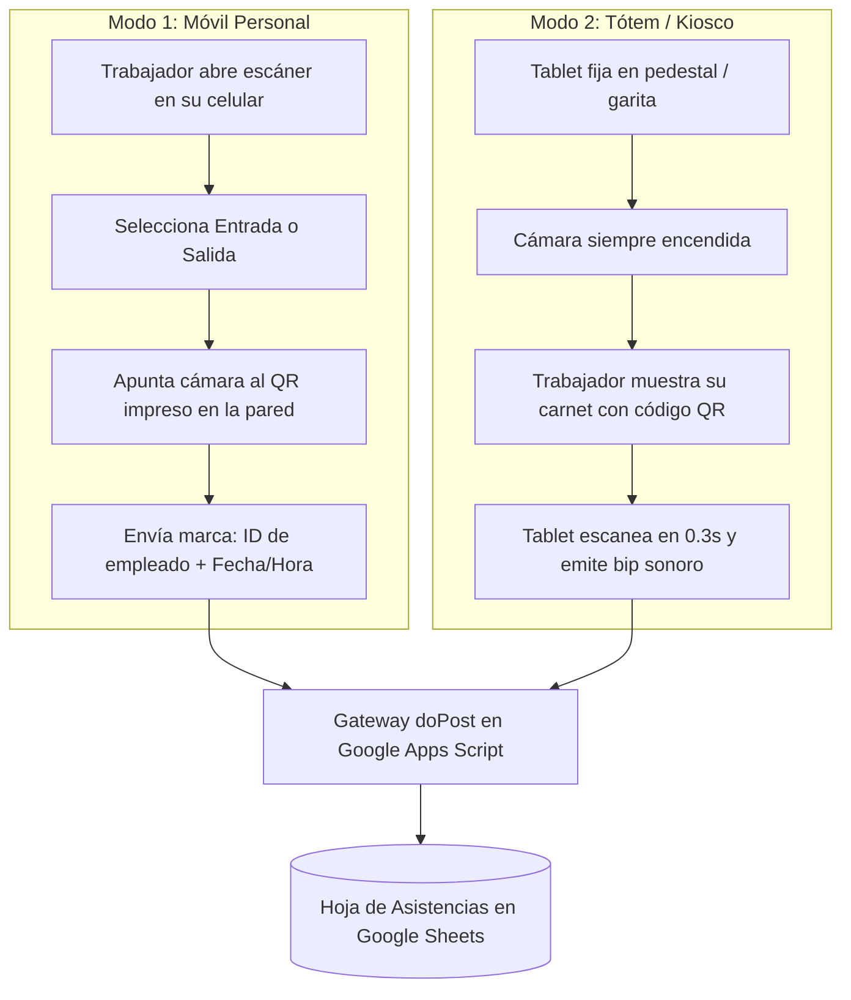

# 📖 Manual Definitivo: Despliegue del Escáner QR en Vercel y Vinculación con Asys Constructora

Este documento explica de forma clara, detallada y paso a paso cómo colocar el lector de códigos QR (**ASIS Scanner Pro**) en **Vercel** y cómo conectarlo directamente con tu sistema de control de asistencias (**Google Apps Script / Google Sheets**).

---

## 🧭 Índice Rápido
1. [¿Por qué alojar el Escáner en Vercel?](#1-por-qué-alojar-el-escáner-en-vercel)
2. [Estructura del Escáner en tu Carpeta](#2-estructura-del-escáner-en-tu-carpeta)
3. [Paso 1: Desplegar el Escáner en Vercel](#3-paso-1-desplegar-el-escáner-en-vercel)
   - [Opción A: Vía Vercel CLI (Línea de Comandos - Más Rápida)](#opción-a-vía-vercel-cli-la-más-rápida)
   - [Opción B: Vía GitHub + Dashboard Web de Vercel](#opción-b-vía-github--dashboard-web-de-vercel-recomendada-para-equipos)
4. [Paso 2: Obtener la URL de tu Sistema (Google Apps Script)](#4-paso-2-obtener-la-url-de-tu-sistema-google-apps-script)
5. [Paso 3: Vincular el Escáner al Sistema](#5-paso-3-vincular-el-escáner-al-sistema)
   - [Método Manual: Desde el panel de ajustes del escáner](#método-manual-desde-el-panel-de-ajustes-del-escáner)
   - [Método Automático: Enlace Mágico por URL (Zero-Config)](#método-automático-enlace-mágico-por-url-zero-config)
6. [Modos de Uso del Escáner](#6-modos-de-uso-del-escáner)
7. [Funcionamiento Offline (Sin Internet en Obra)](#7-funcionamiento-offline-sin-internet-en-obra)
8. [Resolución de Problemas Frecuentes (FAQ)](#8-resolución-de-problemas-frecuentes-faq)

---

## 1. ¿Por qué alojar el Escáner en Vercel?

En la versión original, el lector QR corría dentro del panel de Google Apps Script. Esto presentaba tres problemas graves:
1. **Restricción de Cámara en iframes:** Google Apps Script encapsula todo en un `<iframe>` de `googleusercontent.com`, lo que causa que navegadores como Chrome en Android o Safari en iPhone bloqueen o pregunten permisos de cámara constantemente.
2. **Sin Modo PWA (App Móvil):** No se podía instalar como icono en el celular ni usar a pantalla completa.
3. **Lentitud de Carga:** El servidor de Apps Script tarda entre 3 y 8 segundos en renderizar la interfaz.

**Al estar en Vercel:**
- Carga en **menos de 0.5 segundos** desde los servidores perimetrales de Vercel (Edge CDN).
- Tiene **acceso nativo y directo a la cámara** trasera y delantera del celular con linterna/flash.
- Es una **PWA instalable**: El trabajador o guardia pulsa *"Agregar a la pantalla de inicio"* y tiene una app que abre al instante.
- **Resiliencia Offline:** Si no hay señal en la obra o en el sótano, las marcas se guardan en el teléfono y se sincronizan solas cuando vuelve el internet.

---

## 2. Estructura del Escáner en tu Carpeta

Todos los archivos del escáner ya están creados y listos dentro de la subcarpeta:
📁 `c:\Users\Maria\Desktop\SCRIPTS\Asys constructora\asys-qr-scanner\`

Contenido de la carpeta:
- `index.html`: Interfaz visual moderna, oscura y optimizada para celulares y tablets.
- `styles.css`: Estilos visuales de alto rendimiento con animaciones de escaneo láser.
- `app.js`: Cerebro del escáner (control de cámara, audio bip de confirmación, cola offline y despachador HTTP).
- `manifest.json`: Archivo de configuración PWA para que se instale como App nativa.
- `sw.js`: Service Worker que permite abrir el escáner incluso sin conexión a internet.
- `vercel.json`: Reglas de cabeceras de Vercel (permite cámara y CORS abierto).
- `package.json`: Definición del proyecto.

---

## 3. Paso 1: Desplegar el Escáner en Vercel

Tienes dos formas muy sencillas de poner el escáner en internet. Elige la que te resulte más cómoda:

### Opción A: Vía Vercel CLI (La más rápida)

Si tienes Node.js instalado en tu computadora:

1. Abre tu terminal de **PowerShell** en tu computadora.
2. Entra a la carpeta del escáner:
   ```powershell
   cd "c:\Users\Maria\Desktop\SCRIPTS\Asys constructora\asys-qr-scanner"
   ```
3. Ejecuta el comando de Vercel:
   ```powershell
   npx vercel
   ```
4. **Respuestas a las preguntas:**
   - Si es la primera vez, se abrirá tu navegador para que inicies sesión en Vercel (puedes entrar con Google o GitHub).
   - `Set up and deploy?`: Presiona `Y` y `Enter`.
   - `Which scope?`: Presiona `Enter` (tu usuario).
   - `Link to existing project?`: Presiona `N` y `Enter`.
   - `What's your project's name?`: Escribe `asys-qr-scanner` (o presiona `Enter`).
   - `In which directory is your code located?`: Presiona `Enter` (indica `./`).
   - `Want to modify these settings?`: Presiona `N` y `Enter`.
5. Vercel subirá los archivos y te dará una URL de prueba.
6. Ahora publica en **producción final** ejecutando:
   ```powershell
   npx vercel --prod
   ```
7. 🎉 ¡Listo! Recibirás tu enlace público permanente con certificado SSL (HTTPS), por ejemplo:
   `https://asys-qr-scanner.vercel.app`

---

### Opción B: Vía GitHub + Dashboard Web de Vercel (Recomendada para equipos)

1. **Crear repositorio en GitHub:**
   - Entra a [github.com](https://github.com) y crea un nuevo repositorio llamado `asys-qr-scanner` (puede ser público o privado).
2. **Subir la carpeta a GitHub:**
   En tu terminal dentro de `asys-qr-scanner`:
   ```powershell
   git init
   git add .
   git commit -m "Lanzamiento inicial ASIS Scanner Pro"
   git branch -M main
   git remote add origin https://github.com/TU_USUARIO/asys-qr-scanner.git
   git push -u origin main
   ```
3. **Conectar con Vercel:**
   - Entra a [vercel.com](https://vercel.com) e inicia sesión.
   - En tu panel principal, haz clic en el botón azul **"Add New..."** ➔ **"Project"**.
   - Verás tu repositorio `asys-qr-scanner` en la lista. Haz clic en **"Import"**.
   - En *Framework Preset*, déjalo en **"Other"** (es un sitio web estático optimizado).
   - Haz clic en **"Deploy"**.
4. En menos de 20 segundos verás una lluvia de confeti digital y tu sitio estará en vivo con su URL `https://asys-qr-scanner.vercel.app`.

---

## 4. Paso 2: Obtener la URL de tu Sistema (Google Apps Script)

Para que el escáner de Vercel pueda enviar las marcas de asistencia a tu hoja de cálculo, necesita la URL de la aplicación web de Google Apps Script donde está configurada la función `doPost(e)`.

> [!IMPORTANT]
> El archivo [`Código.js`](file:///c:/Users/Maria/Desktop/SCRIPTS/Asys%20constructora/C%C3%B3digo.js#L260-L360) de tu sistema ya cuenta con el gateway `doPost(e)` completamente programado para recibir `recordAttendance`, `ping` y `validateUser`.

Sigue estos pasos en tu proyecto de Google Apps Script:

1. Abre tu hoja de cálculo de Google o entra directamente al editor de Apps Script ([script.google.com](https://script.google.com)).
2. Asegúrate de que el código más reciente de [`Código.js`](file:///c:/Users/Maria/Desktop/SCRIPTS/Asys%20constructora/C%C3%B3digo.js) esté guardado.
3. En la esquina superior derecha, haz clic en el botón azul **Implementar** (Deploy) y selecciona:
   - Si es la primera vez: **Nueva implementación**.
   - Si ya existía: **Gestionar implementaciones** ➔ icono de lápiz para editar ➔ selecciona **Nueva versión**.
4. Configura exactamente los siguientes 3 campos:
   - **Tipo:** Selecciona el engranaje ➔ **Aplicación web**.
   - **Descripción:** `Gateway Escáner Vercel v2.0`.
   - **Ejecutar como:** `Yo (tu cuenta de correo de Google)`.
   - **Quién tiene acceso:** **`Cualquiera`** *(Cualquier usuario / Anyone)*.
     > ⚠️ **ATENCIÓN CRÍTICA:** Si dejas "Solo yo" o "Cualquiera con cuenta de Google", Vercel será bloqueado por la pantalla de inicio de sesión de Google y las marcas fallarán. Debe decir **"Cualquiera"**.
5. Haz clic en **Implementar**.
6. Copia la **URL de la aplicación web** que te entrega Google. Tendrá un formato como este:
   ```text
   https://script.google.com/macros/s/AKfycbxXXXXXXXXXXXXXXXXXXXXXXXXXXXXXXX/exec
   ```

---

## 5. Paso 3: Vincular el Escáner al Sistema

### Método Manual: Desde el panel de ajustes del escáner

1. Abre la URL de tu escáner en tu navegador o celular (ej: `https://asys-qr-scanner.vercel.app`).
2. En la esquina superior derecha, pulsa el icono de **Tuerca (⚙️ Ajustes)**.
3. Se abrirá el modal de configuración:
   - En el campo **"URL del Endpoint (Google Apps Script / API)"**, pega la URL que copiaste en el Paso 2 (`https://script.google.com/macros/s/.../exec`).
   - En **"Modo de Operación"**, selecciona si ese dispositivo será para un empleado (*Modo Móvil Personal*) o una tablet fija en la entrada (*Modo Tótem / Kiosco*).
   - Deja el ID maestro como `QR-MAESTRO-ASISTENCIA-V1`.
4. Haz clic en el botón blanco: **"Probar Conexión con Servidor"**.
   - El escáner enviará una señal `ping` a tu `doPost`.
   - Si todo está correcto, saldrá un aviso verde: *"¡Conexión Exitosa! Gateway de Asistencia ASIS v2.0 Activo y Operativo"*.
5. Haz clic en el botón azul **"Guardar y Aplicar"**.
   - Los datos se guardan en el almacenamiento local del navegador (`localStorage`). No tendrás que volver a configurarlo en ese equipo.

---

### Método Automático: Enlace Mágico por URL (Zero-Config)

Para que ningún trabajador ni supervisor tenga que copiar ni pegar URLs largas en los ajustes, puedes compartirles un **enlace pre-configurado**:

#### Para Celulares de Empleados (Modo Personal):
```text
https://tu-scanner.vercel.app/?endpoint=https://script.google.com/macros/s/AKfycbx.../exec&mode=master
```

#### Para Tablets de Entrada / Garita de Guardia (Modo Tótem):
```text
https://tu-scanner.vercel.app/?endpoint=https://script.google.com/macros/s/AKfycbx.../exec&mode=badge
```

**¿Qué ocurre al abrir este enlace?**
El escáner lee los parámetros de la URL, guarda la dirección del servidor silenciosamente en segundo plano y deja la cámara encendida lista para escanear sin que el usuario toque ninguna configuración.

> [!TIP]
> Puedes generar un código QR con ese "Enlace Mágico" y colocarlo en un cartel visible en la oficina de RRHH con el título: *"Escanea aquí para instalar el lector de asistencia en tu celular"*.

---

## 6. Modos de Uso del Escáner

El escáner admite dos operativas según las necesidades de la obra o sede:



### Modo 1: Móvil Personal
1. El trabajador abre el escáner en su teléfono.
2. La primera vez, pulsa **"Cambiar"** en su tarjeta de usuario e ingresa su Cédula/DNI y Nombre.
3. Cuando llega a la obra, pulsa **"ENTRADA"** y apunta la cámara al código QR impreso en la entrada de la obra (`QR-MAESTRO-ASISTENCIA-V1`).
4. El escáner emite un sonido alegre de confirmación y registra la hora exacta.
5. Al salir de su turno, pulsa **"SALIDA"** y vuelve a escanear.

### Modo 2: Tótem o Kiosco (Tablet Fija)
1. Se fija una tablet o celular antiguo en la entrada de la constructora.
2. En Ajustes se configura el modo **"Modo Tótem / Kiosco"**.
3. La cámara queda activa de forma continua.
4. Cada empleado llega y muestra su carnet o gafete con su QR personal (que contiene su DNI).
5. El sistema detecta el carnet en menos de 0.5 segundos, emite un aviso sonoro, registra la asistencia y queda listo de inmediato para el siguiente trabajador.

---

## 7. Funcionamiento Offline (Sin Internet en Obra)

En faenas de construcción, subterráneos o zonas rurales donde no hay cobertura 4G:
1. El escáner funciona de forma completamente autónoma gracias a su **Service Worker** local.
2. Si un trabajador escanea su entrada sin internet:
   - El escáner registra la asistencia en la memoria interna segura del navegador.
   - Muestra un aviso ámbar: *"Guardado Local (Sin Red). Se sincronizará al recuperar internet"*.
   - Se muestra un contador arriba: *"⚠ Tienes 3 marcas guardadas en la memoria local"*.
3. En el momento en que el teléfono o tablet se conecta a una red WiFi o recupera datos móviles:
   - El escáner detecta la red automáticamente y despacha en ráfaga todas las marcas acumuladas al servidor de Google Sheets.
   - También cuenta con el botón manual **"Sincronizar Ahora"**.

---

## 8. Resolución de Problemas Frecuentes (FAQ)

### ❓ "Al escanear me dice: Error al conectar con el servidor / Falló la red"
- **Causa:** La URL del Web App de Apps Script no está bien configurada o no tiene permisos públicos.
- **Solución:** Ve a tu editor de Google Apps Script ➔ *Implementar* ➔ *Gestionar implementaciones*. Verifica que la opción **"Quién tiene acceso"** esté en **"Cualquiera"**. Si estaba en "Solo yo", cámbiala a "Cualquiera" y haz clic en *Implementar*.

### ❓ "El navegador del celular no abre la cámara"
- **Causa:** Los navegadores móviles exigen conexiones seguras con protocolo `HTTPS` para activar la cámara web.
- **Solución:** Vercel entrega certificados SSL automáticos gratuitos (`https://`). Asegúrate de abrir la URL con `https://` y no con `http://`. Cuando el navegador pregunte *"¿Permitir a esta web usar tu cámara?"*, presiona **Permitir**.

### ❓ "Hice cambios en el código de Google Apps Script pero el escáner no los toma"
- **Causa:** En Google Apps Script, para que los cambios en `Código.js` tomen efecto en la URL `/exec`, debes publicar una **nueva versión**.
- **Solución:** Haz clic en *Implementar* ➔ *Gestionar implementaciones* ➔ icono de lápiz en la implementación activa ➔ en el desplegable de versión selecciona **"Nueva versión"** ➔ presiona *Implementar*. La URL no cambiará y se actualizará al instante.

### ❓ "¿Cómo genero el QR Maestro para imprimirlo y pegarlo en la pared?"
- Cualquier generador de QR gratuito (como [qr-code-generator.com](https://www.qr-code-generator.com/)) sirve.
- Genera un QR de tipo texto plano con el contenido:
  ```text
  QR-MAESTRO-ASISTENCIA-V1
  ```
- Imprime este QR, plastifícalo y colócalo en el punto de control de acceso de la constructora.
