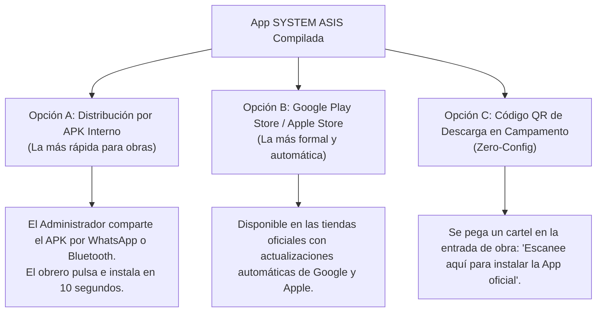

# 📱 Guía Técnica Definitiva: Escalabilidad a App Telefónica Nativa para Android e iOS (SYSTEM ASIS)

**Proyecto:** Sistema de Control de Asistencia QR Inteligente  
**Entidades:** Ministerio del Poder Popular para Hábitat y Vivienda / Constructora del Alba Bolivariana  
**Objetivo:** Empaquetar y desplegar el sistema actual como una aplicación móvil nativa instalable en smartphones **Android (.apk / .aab)** y **Apple iOS (.ipa)** con acceso a cámara de alta velocidad a 60 FPS, biometría nativa y persistencia offline total.

---

## 🧭 Índice de la Guía

1. [¿Por qué evolucionar a una App Móvil Nativa?](#1-por-qué-evolucionar-a-una-app-móvil-nativa)
2. [Evaluación de Tecnologías y Estrategia Recomendada](#2-evaluación-de-tecnologías-y-estrategia-recomendada)
3. [Requisitos Previos de Desarrollo](#3-requisitos-previos-de-desarrollo)
4. [Paso a Paso: Configuración con CapacitorJS](#4-paso-a-paso-configuración-con-capacitorjs)
5. [Integración de Plugins Nativos de Alto Rendimiento](#5-integración-de-plugins-nativos-de-alto-rendimiento)
   - [A. Escaneo QR Nativo con GPU (Barcode Scanner)](#a-escaneo-qr-nativo-con-gpu-barcode-scanner)
   - [B. Identificador de Hardware Real del Teléfono (Device ID)](#b-identificador-de-hardware-real-del-teléfono-device-id)
   - [C. Biometría Nativa (Huella Dactilar y Face ID)](#c-biometría-nativa-huella-dactilar-y-face-id)
   - [D. Base de Datos SQLite Nativa para Modo Offline en Obra](#d-base-de-datos-sqlite-nativa-para-modo-offline-en-obra)
6. [Compilación y Generación para Android (APK y Play Store)](#6-compilación-y-generación-para-android-apk-y-play-store)
7. [Compilación y Generación para Apple iOS (TestFlight y App Store)](#7-compilación-y-generación-para-apple-ios-testflight-y-app-store)
8. [Estrategias de Distribución en Obra (Interna vs Tiendas Oficiales)](#8-estrategias-de-distribución-en-obra-interna-vs-tiendas-oficiales)
9. [Actualizaciones Rápidas en Caliente (Over-The-Air / Live Updates)](#9-actualizaciones-rápidas-en-caliente-over-the-air--live-updates)

---

## 1. ¿Por qué evolucionar a una App Móvil Nativa?

Aunque la versión actual (PWA / Web en Vercel) funciona de manera excelente en navegadores modernos, transformarla en una **App Telefónica Nativa** desbloquea ventajas estratégicas cruciales para el sector de la construcción:

| Característica | Versión Web / PWA Actual | App Móvil Nativa (Android / iOS) |
|---|:---:|:---:|
| **Acceso a Cámara** | Vía navegador (con solicitud de permisos web) | **Directo por hardware**: escaneo a 60 FPS con auto-enfoque y linterna instantánea |
| **Identificación de Dispositivo** | Token local en navegador (`localStorage`) | **UUID de hardware real del procesador** (100% inviolable) |
| **Biometría** | Dependiente de WebAuthn | **Huella dactilar y Face ID nativos del teléfono** |
| **Funcionamiento sin Internet** | Caché de Service Worker | **Base de datos SQLite local** con almacenamiento seguro de miles de marcajes en campamentos sin cobertura |
| **Instalación para Obreros** | Vía menú "Agregar a Inicio" | **Icono oficial en pantalla**, distribución por WhatsApp/APK o descarga de Play Store |
| **Cierre Forzado / Segundo Plano** | Limitado por el navegador | Servicio nativo en segundo plano que sincroniza en cuanto detecta red WiFi o datos |

---

## 2. Evaluación de Tecnologías y Estrategia Recomendada

Para escalar el sistema actual sin tener que reescribir desde cero los meses de trabajo ya invertidos, evaluamos tres caminos:

```
┌────────────────────────────────────────────────────────────────────────┐
│                      CAMINOS DE ESCALABILIDAD MÓVIL                    │
├──────────────────────┬──────────────────────┬──────────────────────────┤
│ 1. Reescribir en     │ 2. Trusted Web       │ 3. CAPACITOR JS / IONIC  │
│ Flutter/React Native │    Activity (TWA)    │    (Estrategia Ganadora) │
├──────────────────────┼──────────────────────┼──────────────────────────┤
│ ❌ Costo muy alto    │ ❌ Solo sirve para   │ ✅ Reutiliza el 100%     │
│ ❌ Meses de desarrollo│   Android           │    del código existente  │
│ ❌ Duplicidad de     │ ❌ Sigue dentro del  │ ✅ Acceso a APIs nativas │
│    código            │    navegador Chrome  │ ✅ Compila Android e iOS │
└──────────────────────┴──────────────────────┴──────────────────────────┘
```

### 🏆 La Estrategia Ganadora: CapacitorJS (de Ionic Framework)
Capacitor es el estándar moderno creado para empaquetar aplicaciones web modernas dentro de contenedores nativos oficiales:
1. Crea un proyecto nativo real en **Android Studio** (código Java/Kotlin).
2. Crea un proyecto nativo real en **Xcode** (código Swift/Objective-C).
3. Permite invocar funciones nativas del teléfono mediante JavaScript estándar.

---

## 3. Requisitos Previos de Desarrollo

Para compilar las aplicaciones necesitarás contar con el siguiente entorno en la computadora de desarrollo:

### Para Desarrollar la App Android:
* **Node.js:** Versión 18 LTS o 20 LTS ([nodejs.org](https://nodejs.org)).
* **Android Studio:** Versión Jellyfish o superior ([developer.android.com/studio](https://developer.android.com/studio)).
* **Java Development Kit (JDK):** Versión 17 o 21 (OpenJDK).
* **Android SDK:** Con API Level 33 o 34 instalado desde el SDK Manager de Android Studio.

### Para Desarrollar la App iOS (iPhone / iPad):
* **Computadora Apple:** MacBook, Mac mini o iMac con macOS Sonoma o Sequoia.
* **Xcode:** Versión 15 o superior (descargable desde la Mac App Store).
* **Cocoapods:** Gestor de dependencias iOS (`sudo gem install cocoapods`).
* **Apple Developer Program:** Cuenta de desarrollador ($99/año) únicamente requerida para publicar en App Store o TestFlight.

---

## 4. Paso a Paso: Configuración con CapacitorJS

Podemos convertir la carpeta de escaneo existente (`asys-qr-scanner`) o la raíz del proyecto en una app nativa ejecutando estos comandos en tu terminal de PowerShell:

### Paso 4.1. Ingresar a la carpeta del proyecto
```powershell
cd "c:\Users\Maria\Desktop\SCRIPTS\Asys constructora\asys-qr-scanner"
```

### Paso 4.2. Instalar el núcleo de Capacitor
```powershell
npm install @capacitor/core @capacitor/cli --save
```

### Paso 4.3. Inicializar la App con la identidad institucional
```powershell
npx cap init "Constructora del Alba" "com.alba.asis" --web-dir "."
```
* **Nombre de la App:** `"Constructora del Alba"` (el que verá el obrero bajo el icono).
* **ID de Paquete:** `"com.alba.asis"` (identificador único mundial para Play Store y App Store).
* **Web Dir:** `.` (indica que los archivos HTML, CSS y JS están en la carpeta actual).

### Paso 4.4. Agregar las plataformas nativas Android e iOS
```powershell
# Instalar los módulos de plataforma
npm install @capacitor/android @capacitor/ios --save

# Crear los proyectos nativos
npx cap add android
npx cap add ios
```

Al terminar este comando, se habrán creado dos carpetas nativas en tu proyecto:
* 📁 `android/`: Proyecto completo y 100% nativo de Android Studio.
* 📁 `ios/`: Proyecto completo y 100% nativo de Xcode.

---

## 5. Integración de Plugins Nativos de Alto Rendimiento

Para llevar la experiencia al máximo nivel profesional, instalamos 4 plugins nativos:

```powershell
npm install @capacitor/camera @capacitor/device @capacitor/network @capacitor-community/barcode-scanner @capacitor-community/sqlite --save
```

### A. Escaneo QR Nativo con GPU (Barcode Scanner)
En lugar de procesar los fotogramas de la cámara mediante el software del navegador, el plugin de Barcode Scanner utiliza el procesador gráfico (GPU) y la librería nativa de Google ML Kit:
* Escanea en menos de **30 milisegundos**.
* Lee códigos QR doblados, sucios, con polvo de obra o con poca luz.
* Control total de la linterna (*flashlight*).

**Ejemplo de integración en JavaScript:**
```javascript
import { BarcodeScanner } from '@capacitor-community/barcode-scanner';

async function startNativeScanner() {
  // Solicitar permiso de cámara al sistema operativo
  const status = await BarcodeScanner.checkPermission({ force: true });
  if (!status.granted) {
    alert("Se requiere permiso de cámara para marcar asistencia.");
    return;
  }

  // Hacer el fondo transparente para ver la cámara nativa detrás del HTML
  await BarcodeScanner.hideBackground();
  document.body.style.backgroundColor = 'transparent';

  // Iniciar escaneo ultra-rápido
  const result = await BarcodeScanner.startScan();
  if (result.hasContent) {
    document.body.style.backgroundColor = '';
    procesarCodigoQR(result.content);
  }
}
```

---

### B. Identificador de Hardware Real del Teléfono (Device ID)
Con el plugin `@capacitor/device`, el sistema puede leer el identificador de hardware nativo del teléfono, blindando al 100% el requerimiento de **1 solo equipo por trabajador**:

```javascript
import { Device } from '@capacitor/device';

async function obtenerIdentificadorNativo() {
  const info = await Device.getId();
  const battery = await Device.getBatteryInfo();
  const deviceInfo = await Device.getInfo();

  return {
    hardwareUUID: info.identifier, // Identificador único de placa del fabricante
    modelo: `${deviceInfo.manufacturer} ${deviceInfo.model}`,
    sistemaOperativo: `${deviceInfo.operatingSystem} ${deviceInfo.osVersion}`
  };
}
```

---

### C. Biometría Nativa (Huella Dactilar y Face ID)
Podemos agregar la opción de que el trabajador confirme su identidad posando su huella dactilar o mirando la cámara tras escanear el QR:

```javascript
import { NativeBiometric } from 'capacitor-native-biometric';

async function verificarHuellaObrero() {
  const result = await NativeBiometric.isAvailable();
  if (!result.isAvailable) return true; // Si el teléfono no tiene lector, omitir

  try {
    await NativeBiometric.verifyIdentity({
      reason: "Confirma tu identidad para registrar asistencia",
      title: "Control Biométrico Constructora del Alba",
      subtitle: "Coloca tu huella en el sensor",
      description: "Verificación de presencia física"
    });
    return true;
  } catch (error) {
    alert("Verificación biométrica rechazada.");
    return false;
  }
}
```

---

### D. Base de Datos SQLite Nativa para Modo Offline en Obra
En campamentos remotos donde no hay cobertura de datos, los registros se insertan en una base de datos local SQLite encriptada en el teléfono. En cuanto el celular detecta conexión a internet (`Network.addListener`), sincroniza el lote de asistencias automáticamente hacia la base de datos de Supabase.

---

## 6. Compilación y Generación para Android (APK y Play Store)

### Paso 6.1. Sincronizar el código HTML/JS con Android
Cada vez que hagas un cambio en tus pantallas o scripts, ejecuta:
```powershell
npx cap copy android
npx cap sync android
```

### Paso 6.2. Abrir el proyecto en Android Studio
```powershell
npx cap open android
```
Esto abrirá Android Studio automáticamente cargando todo el proyecto.

### Paso 6.3. Configurar Permisos en `AndroidManifest.xml`
Asegúrate de que en `android/app/src/main/AndroidManifest.xml` figuren los siguientes permisos:
```xml
<uses-permission android:name="android.permission.CAMERA" />
<uses-permission android:name="android.permission.INTERNET" />
<uses-permission android:name="android.permission.VIBRATE" />
<uses-permission android:name="android.permission.USE_BIOMETRIC" />
```

### Paso 6.4. Generar el archivo `.apk` de instalación directa
1. En Android Studio, ve al menú superior: **Build > Build Bundle(s) / APK(s) > Build APK(s)**.
2. Android Studio compilará la aplicación en 1-2 minutos.
3. Al finalizar, haz clic en el enlace azul **"locate"**.
4. ¡Listo! Obtendrás el archivo `app-debug.apk` que puedes transferir por cable USB, compartir por Telegram o WhatsApp e instalar de inmediato en cualquier teléfono Android.

### Paso 6.5. Generar archivo `.aab` para Google Play Store
1. Menú: **Build > Generate Signed Bundle / APK**.
2. Selecciona **Android App Bundle**.
3. Crea tu clave de firma (*keystore*) y contraseña de la constructora.
4. Presiona **Release** y se generará el archivo `app-release.aab` listo para subir a la consola de Google Play.

---

## 7. Compilación y Generación para Apple iOS (TestFlight y App Store)

### Paso 7.1. Sincronizar el código con iOS
```powershell
npx cap copy ios
npx cap sync ios
```

### Paso 7.2. Abrir en Xcode
```powershell
npx cap open ios
```

### Paso 7.3. Permisos en `Info.plist`
Apple exige que expliques por qué solicitas la cámara. En Xcode, abre `App/Info.plist` y añade:
```xml
<key>NSCameraUsageDescription</key>
<string>El sistema requiere la cámara para el escaneo del código QR de control de asistencia de la constructora.</string>
<key>NSFaceIDUsageDescription</key>
<string>Se requiere Face ID para verificar la identidad del trabajador.</string>
```

### Paso 7.4. Compilar en iPhone
1. Conecta tu iPhone por cable a la computadora Mac.
2. En la barra superior de Xcode, selecciona tu iPhone como dispositivo destino.
3. Presiona el botón ▶️ **Play (Run)**.
4. La aplicación se instalará directamente en tu iPhone.

---

## 8. Estrategias de Distribución en Obra (Interna vs Tiendas Oficiales)

Para una empresa constructora, existen tres formas muy prácticas de poner la app en los teléfonos de los obreros:



### Recomendación Operativa:
* Para el personal obrero en campo, la **Opción A (Distribución por APK interno o enlace directo en servidor Vercel/Drive)** es la más veloz, ya que no depende de revisiones ni tiempos de aprobación de Google o Apple.

---

## 9. Actualizaciones Rápidas en Caliente (Live Updates)

Una ventaja enorme de haber usado Capacitor es que puedes integrar **Capacitor Live Updates (Appflow)** o un actualizador propio:
* Si mañana cambias el diseño de una pantalla, agregas un turno o modificas un reporte, **no necesitas compilar ni reinstalar el APK en los teléfonos de los obreros**.
* El código web se actualiza en el servidor y la app telefónica descarga los cambios automáticamente en segundo plano la próxima vez que el trabajador la abre.

---

## 10. Conclusión y Hoja de Ruta Sugerida

1. **Estado Actual:** El sistema web y PWA ya está 100% operativo con la sábana de asistencia semanal, el turno nocturno, la identidad del MPPVH y la validación de equipo.
2. **Fase Inmediata:** Desplegar el escáner PWA actual en Vercel para que los obreros comiencen a usarlo desde sus navegadores móviles.
3. **Fase de Escalabilidad Nativa:** Ejecutar los comandos de Capacitor detallados en esta guía para generar el archivo instalable **`ConstructoraAlba_ASIS.apk`** y distribuirlo entre las cuadrillas de trabajo.

