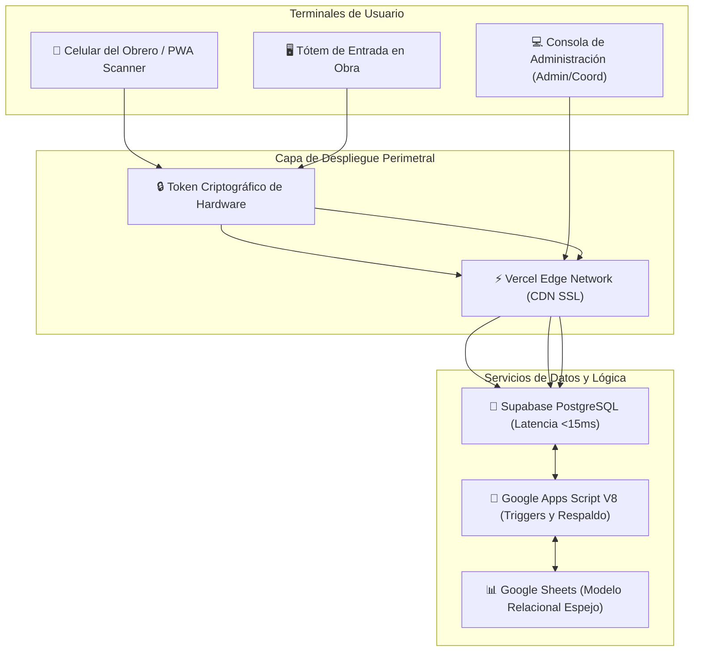

# 📖 Manual Técnico y Operativo Integral del Sistema de Control de Asistencia QR (SYSTEM ASIS v2.5)

**Institución Superior:** Ministerio del Poder Popular para Hábitat y Vivienda (MPPVH)  
**Ente Ejecutor:** Constructora del Alba Bolivariana  
**Versión del Sistema:** v2.5 (Producción / Sábana Semanal, Dispositivo Único & Turno Nocturno)  
**Zona Horaria de Operación:** `America/Caracas` (GMT-4)  
**Fecha de Publicación:** 29 de Octubre de 2026  

---

## 🧭 Índice General

1. [Visión General e Identidad Institucional](#1-visión-general-e-identidad-institucional)
2. [Arquitectura Tecnológica del Sistema](#2-arquitectura-tecnológica-del-sistema)
3. [Módulo de Autenticación Simplificada (Primer Nombre / Cédula)](#3-módulo-de-autenticación-simplificada-primer-nombre--cédula)
4. [Módulo de Validación de Dispositivo Único (Anti-Fraude)](#4-módulo-de-validación-de-dispositivo-único-anti-fraude)
5. [Gestión de Turnos y Guardias Nocturnas](#5-gestión-de-turnos-y-guardias-nocturnas)
6. [Generador de Sábana de Asistencia Semanal (Excel)](#6-generador-de-sábana-de-asistencia-semanal-excel)
7. [Escáner QR Multisensorial (Terminal Web y PWA Vercel)](#7-escáner-qr-multisensorial-terminal-web-y-pwa-vercel)
8. [Matriz de Roles y Permisos Jerárquicos (RBAC)](#8-matriz-de-roles-y-permisos-jerárquicos-rbac)
9. [Automatizaciones y Triggers Diarios del Sistema](#9-automatizaciones-y-triggers-diarios-del-sistema)
10. [Mantenimiento, Diagnóstico y Respaldo](#10-mantenimiento-diagnóstico-y-respaldo)

---

## 1. Visión General e Identidad Institucional

El **Sistema de Control de Asistencia QR Inteligente (SYSTEM ASIS v2.5)** es una solución tecnológica desarrollada para garantizar la máxima transparencia, disciplina y eficiencia en la gestión del talento humano operativo y administrativo de la **Constructora del Alba Bolivariana**, bajo las directrices estratégicas del **Ministerio del Poder Popular para Hábitat y Vivienda**.

### Principios Operativos Rectores:
* **Transparencia Inviolable:** Erradicación del fraude laboral (marcajes por terceros o "buddy punching").
* **Facilidad para el Personal de Obra:** Eliminación de correos electrónicos complejos; acceso inmediato con el primer nombre o la cédula de identidad.
* **Resiliencia Operativa:** Funcionamiento fluido tanto en obra con baja cobertura como en sedes administrativas centrales.
* **Reportes Ejecutivos Listos para Nómina:** Generación directa de la Sábana Semanal de Asistencia oficial en formato Microsoft Excel (.xlsx) con base dinámica de cálculo (6/6 o 7/7).

---

## 2. Arquitectura Tecnológica del Sistema

El ecosistema opera sobre una arquitectura desacoplada de alto rendimiento:

### Componentes de la Arquitectura:
1. **Frontend Nativo SPA (Single Page Application):** Creado en HTML5, CSS3 Glassmorphism y Bootstrap, servido con tiempos de carga inferiores a 0.5 segundos.
2. **PostgreSQL Relacional (Supabase):** Tablas normalizadas con índices B-Tree para consultas ultrarrápidas, triggers PL/pgSQL y políticas de seguridad a nivel de filas (RLS).
3. **Google Apps Script V8 (Motor Alterno):** Compatibilidad con el ecosistema de Google Workspace y ejecución de triggers cronometrados automáticos.
4. **Motor de Exportación SheetJS & docx.js:** Procesamiento de reportes directamente en el navegador del cliente sin consumir cuotas de servidor.

---

## 3. Módulo de Autenticación Simplificada (Primer Nombre / Cédula)

Para eliminar las fricciones habituales de los obreros y trabajadores que no poseen o no recuerdan un correo electrónico corporativo, el sistema cuenta con un motor de resolución inteligente:

### 3.1. Identificadores Válidos de Acceso:
* **Primer Nombre:** Si el trabajador se llama *"Brando José González"*, puede escribir simplemente **`brando`**.
* **Cédula de Identidad:** Puede ingresar **`12345678`**, **`V-12345678`** o **`V12345678`**; el sistema normaliza los caracteres numéricos automáticamente.
* **Correo o ID Tradicional:** Se mantiene la compatibilidad para usuarios preexistentes o personal directivo.

### 3.2. Mecanismo de Seguridad y Desempate:
* Si en la constructora coinciden dos trabajadores con el mismo primer nombre (ej. dos *"Carlos"*), el sistema evalúa la contraseña ingresada para conceder acceso al perfil correcto.
* De existir ambigüedad, el sistema sugiere ingresar la **Cédula de Identidad**, que es personal, única e irrepetible.
* **Auto-Blindaje Criptográfico:** Cualquier contraseña registrada en texto plano es convertida de manera automática e invisible al estándar criptográfico **SHA-256 con Salt de 16 caracteres** en el momento de iniciar sesión.

---

## 4. Módulo de Validación de Dispositivo Único (Anti-Fraude)

Este módulo erradica el problema común en obras donde un trabajador que falta le entrega sus credenciales a un compañero para que marque por él.

### 4.1. Funcionamiento Técnico:
1. **Firma Digital del Equipo:** En el primer acceso o escaneo QR, el dispositivo genera un identificador criptográfico (`device_uuid`) persistido de forma segura en el almacenamiento local del navegador (`localStorage` e `IndexedDB`).
2. **Huella de Hardware (Fingerprint):** Se capturan parámetros como el modelo de equipo, resolución de pantalla, sistema operativo y renderizador gráfico.
3. **Vinculación Inicial:** En la primera marca, el equipo queda registrado en la base de datos en los campos `dispositivo_vinculado_id`, `dispositivo_info` y `dispositivo_fecha_vinculacion`.
4. **Bloqueo Inmediato:** Si el usuario intenta marcar desde otro celular o computadora, el sistema compara las firmas y rechaza el marcaje:
   > ⛔ *"Marcaje rechazado por seguridad: Este usuario ya está vinculado a su equipo autorizado. Para evitar fraudes, solo puedes marcar desde tu teléfono registrado."*

### 4.2. Desvinculación Administrativa (Reset de Equipo):
* En caso de robo, extravío o renovación de teléfono del trabajador, el **SuperAdmin**, **Administrador** o **Coordinador** dispone del botón:  
  🔄 **"Reset Equipo"** en la tabla de personal.
* Al pulsarlo, el registro del equipo se borra con 1 clic, permitiendo que el obrero vincule su nuevo teléfono en su siguiente marcaje de forma transparente.

---

## 5. Gestión de Turnos y Guardias Nocturnas

El sistema soporta turnos diurnos, mixtos y guardias nocturnas que cruzan la medianoche.

| Turno | Horario Oficial | Horas Reglamentarias | Tolerancia de Entrada | Criterio Operativo |
|---|:---:|:---:|:---:|---|
| **Mañana** | 08:00 a 14:00 | 6 horas | 15 min | Operación matutina en obra y talleres |
| **Tarde** | 14:00 a 19:00 | 5 horas | 15 min | Operación vespertina |
| **Mixto** | 08:00 a 19:00 | 11 horas | 15 min | Jornada continua de personal técnico |
| **Nocturno** | 19:00 a 07:00 | 12 horas | 20 min | Guardias de vigilancia, vaciados de concreto nocturnos y mantenimiento |

### 5.1. Cruce de Medianoche en Guardias Nocturnas:
* El trabajador marca **Entrada** entre las 18:30 y 23:59 del Día $D$.
* El trabajador marca **Salida** entre las 06:00 y 09:00 del Día $D+1$.
* El sistema enlaza ambos registros como **una sola jornada nocturna completa**.
* **Protección de Medianoche:** El trigger que audita salidas a las 23:55 **ignora intencionalmente** a los trabajadores con turno nocturno o guardia activa, impidiendo amonestaciones erróneas.

---

## 6. Generador de Sábana de Asistencia Semanal (Excel)

Es la herramienta central para el departamento de Recursos Humanos y Nómina de la constructora.

### 6.1. Estructura de la Sábana:
* **Membrete Oficial:**
  * Línea 1: `MINISTERIO DEL PODER POPULAR PARA HÁBITAT Y VIVIENDA`
  * Línea 2: `CONSTRUCTORA DEL ALBA BOLIVARIANA`
  * Línea 3: `SÁBANA DE CONTROL DE ASISTENCIA SEMANAL — PERSONAL OPERATIVO`
  * Línea 4: Período auditado y estatus del domingo (LIBRE / LABORABLE).
* **Columnas Maestras:**
  * `N°`: Número correlativo.
  * `NOMBRES Y APELLIDOS`: Nombre completo del trabajador (solo rol Operador).
  * `CÉDULA`: Cédula de identidad (formato V-XXXXXXXX).
  * `DÍAS (Lunes a Domingo)`: Cada día cuenta con 2 sub-columnas: **[Entrada | Salida]**.
  * `TOTAL ASISTENCIA`: Total de días asistidos válidos.
  * `OBSERVACIONES`: Registro automático de incidencias.

### 6.2. Reglas de Negocio Automatizadas:
1. **Día Asistido Válido (+1):** Solo computa si el trabajador registró tanto **Entrada como Salida** en ese día.
2. **Domingo "LIBRE":** Si el domingo no fue laborable, las casillas se autocompletan con la palabra **`LIBRE`**. Si hubo guardia, registra las horas trabajadas.
3. **Base Semanal Dinámica:**
   * Semana ordinaria (Domingo libre): Base sobre 6 (**`X / 6`**, ej. `6/6`, `5/6`).
   * Semana con trabajo dominical: Base sobre 7 (**`X / 7`**, ej. `7/7`, `6/7`).
4. **Descarga Instantánea:** Generada en milisegundos directamente en formato `.xlsx` nativo mediante SheetJS sin cuotas de servidor.

---

## 7. Escáner QR Multisensorial (Terminal Web y PWA Vercel)

El módulo de marcaje opera mediante el escaneo del **Código QR Maestro** ubicado físicamente en las obras y campamentos:

* **Versión Fijada:** Librería `html5-qrcode@2.3.8` que previene pantallas negras en dispositivos Samsung y Xiaomi.
* **Feedback Multisensorial:**
  * 🔊 **Audio Bip Sintético:** Oscilador Web Audio API a 880 Hz por 150 ms (sin requerir archivos de audio externos).
  * 📳 **Respuesta Háptica:** Impulso de vibración de 200 ms en terminales móviles compatibles.
* **Resiliencia Offline:** Si no hay señal en el sótano o en el área de excavación, el escáner guarda el marcaje en la cola local del celular y lo transmite automáticamente en cuanto recupera señal de red.

---

## 8. Matriz de Roles y Permisos Jerárquicos (RBAC)

El sistema implementa 5 niveles de acceso con aislamiento territorial estricto:

| Rol | Alcance Territorial | Permisos Principales |
|---|---|---|
| **SuperAdmin** | Nacional / Global | Acceso total, auditoría del sistema, blindaje criptográfico masivo y configuración de parámetros. |
| **Administrador** | Empresa General | Gestión de todo el personal, exportación de Sábana Semanal, reseteo de equipos y reportes consolidados. |
| **Coordinador General** | Todas las Obras | Supervisión operativa de todas las áreas, aprobación de suplencias y permisos. |
| **Coordinador de Área** | Solo su Obra / Área | Aprobación de permisos, visualización de asistencia y reseteo de equipos **únicamente de sus obreros asignados**. |
| **Operador/a (Obrero)** | Individual | Marcaje de entrada/salida, visualización de su historial propio y badge de estado DENTRO/FUERA. |

---

## 9. Automatizaciones y Triggers Diarios del Sistema

El backend ejecuta procesos en segundo plano para garantizar la consistencia de la información:

1. **Trigger de Cierre de Jornada Diurna (23:55):**
   * Identifica marcajes de entrada sin salida de turnos diurnos.
   * Aplica amonestación automática por omisión de salida y asigna la hora de cierre oficial.
   * Excluye a los trabajadores de turno nocturno.
2. **Trigger de Auditoría de Ausencias (09:00):**
   * Compara los registros del día anterior con la lista de personal activo.
   * Verifica permisos aprobados, guardias nocturnas cumplidas o reposos médicos.
   * Aplica amonestación disciplinaria si la falta no está justificada.

---

## 10. Mantenimiento, Diagnóstico y Respaldo

* **Script SQL de Migración:** El archivo [`migracion_login_nombres_cedulas.sql`](file:///c:/Users/Maria/Desktop/SCRIPTS/Asys%20constructora/migracion_login_nombres_cedulas.sql) contiene la estructura completa para sincronizar la base de datos de Supabase en cualquier momento.
* **Importador Masivo:** El script [`importar_directo_a_supabase.py`](file:///c:/Users/Maria/Desktop/SCRIPTS/Asys%20constructora/importar_directo_a_supabase.py) permite cargar y actualizar lotes de cientos de trabajadores desde archivos CSV de nómina en segundos.
* **Menú Nativo de Google Sheets (`🛠️ Sistema ASIS`):** Permite ejecutar diagnósticos de salud del sistema y verificar la integridad de las columnas directamente desde la hoja de cálculo.

