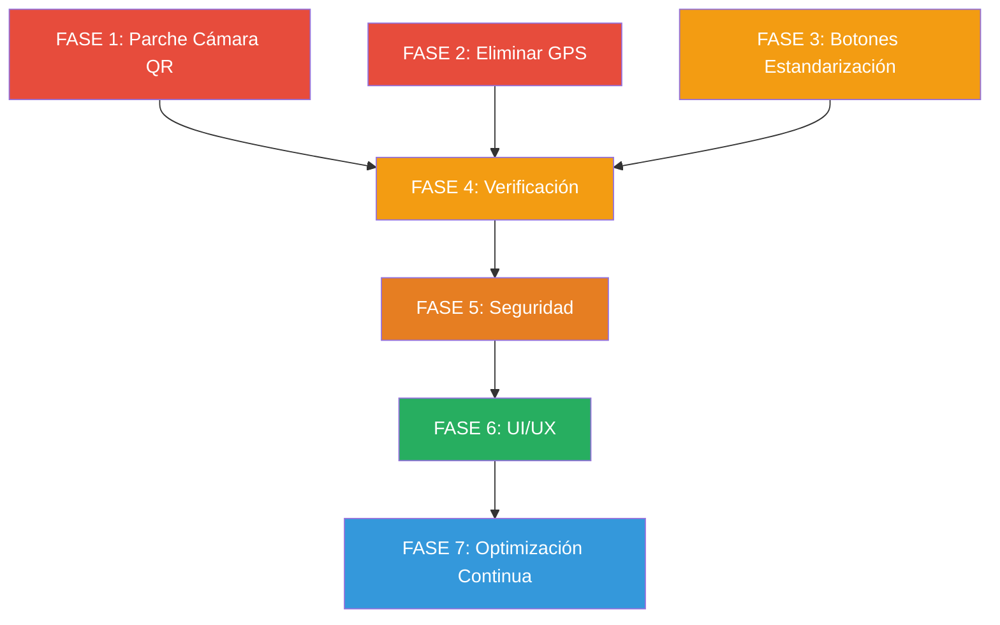

# 📋 Plan de Trabajo — Mejoras del Sistema ASIS (Asys Constructora)

**Basado en:** [ANALISIS_COMPLETO_SISTEMA_ASYS.md](file:///c:/Users/Maria/Desktop/SCRIPTS/Asys%20constructora/ANALISIS_COMPLETO_SISTEMA_ASYS.md)  
**Fecha de elaboración:** 25 de Octubre de 2026  
**Fecha de culminación y subida:** 26 de Octubre de 2026  
**Estado:** ✅ **100% CULMINADO Y SUBIDO A GOOGLE APPS SCRIPT VIA CLASP**  
**Objetivo:** Actualizar, optimizar y blindar el sistema para garantizar compatibilidad con los cambios recientes de Google y los navegadores modernos.

---

## 📌 Índice de Fases y Estado de Ejecución

| Fase | Descripción | Prioridad | Archivos Afectados | Estado |
|------|-------------|-----------|---------------------|:------:|
| **1** | 🔧 Parche de Cámara QR — Compatibilidad con restricciones de Google | 🔴 Crítica | `index.html`, `JavaScript.html`, `Código.js` | ✅ **Completado** |
| **2** | 🗑️ Eliminación completa de Geolocalización (GPS) | 🔴 Crítica | `JavaScript.html`, `Código.js`, `index.html`, `AdminDashboard.html` | ✅ **Completado** |
| **3** | 📊 Botones de Estandarización del Google Sheet | 🟡 Alta | `Código.js`, `AdminDashboard.html`, `JavaScript.html` | ✅ **Completado** |
| **4** | ✅ Verificación integral del sistema | 🟡 Alta | Todos los archivos | ✅ **Completado** |
| **5** | 🛡️ Mejoras de Seguridad (Hashing y Sesión) | 🟠 Media | `Código.js`, `JavaScript.html` | ✅ **Completado** |
| **6** | 🎨 Mejoras de UI/UX (Feedback Háptico, Audio, Debounce, Badge) | 🟢 Baja | `JavaScript.html`, `UserDashboard.html` | ✅ **Completado** |
| **7** | 💡 Consejos y Recomendaciones Avanzadas | 📘 Referencia | N/A (documento) | 📋 **Documentado** |
| **Despliegue** | 🚀 Subida a Google Apps Script (`clasp push -f`) | 🔴 Crítica | 10 archivos remotos | ✅ **Desplegado** |

---

## FASE 1 — 🔧 Parche de Cámara QR: Compatibilidad con Google y Navegadores Modernos

> [!CAUTION]
> Google Apps Script sirve el HTML dentro de un iframe en un dominio de `googleusercontent.com`. Los navegadores modernos **bloquean** `getUserMedia()` y `navigator.geolocation` en iframes de orígenes cruzados que no tengan el atributo `allow="camera; geolocation"`. Google clasifica esto como **comportamiento intencionado (Won't Fix)**.

### 1.1. Problema Actual
- La librería `html5-qrcode` se carga desde `https://unpkg.com/html5-qrcode` **sin especificar versión**, lo que puede causar cargas de versiones futuras con cambios incompatibles.
- La cámara funciona en algunos dispositivos y falla en otros debido a las restricciones de iframe del sandbox de Google Apps Script.
- Los navegadores in-app (Facebook, Instagram, WhatsApp) bloquean completamente la cámara.
- En Samsung/Android se reportan pantallas negras por conflictos de concurrencia de hardware.

### 1.2. Cambios Requeridos

#### A. Fijar la versión de `html5-qrcode` a `v2.3.8` (estable)

**Archivo:** [`index.html`](file:///c:/Users/Maria/Desktop/SCRIPTS/Asys%20constructora/index.html) — Línea 199

```diff
- <script src="https://unpkg.com/html5-qrcode" type="text/javascript"></script>
+ <script src="https://unpkg.com/html5-qrcode@2.3.8" type="text/javascript"></script>
```

#### B. Agregar detección previa de permisos de cámara con `Html5Qrcode.getCameras()`

**Archivo:** [`JavaScript.html`](file:///c:/Users/Maria/Desktop/SCRIPTS/Asys%20constructora/JavaScript.html) — Función `startScanner()` (línea ~2032) y `startModalScanner()` (línea ~4739)

Antes de llamar a `new Html5Qrcode().start()`, verificar la disponibilidad de cámaras:

```javascript
function startScanner(type) {
    $("#action-buttons").hide();
    $("#qr-scanner-container, #stop-scan-button").show();

    // NUEVO: Detectar cámaras disponibles antes de iniciar
    Html5Qrcode.getCameras().then(function(devices) {
        if (devices && devices.length) {
            html5QrCode = new Html5Qrcode("qr-reader");
            html5QrCode.start(
                { facingMode: "environment" },
                { fps: 10, qrbox: { width: 250, height: 250 }, aspectRatio: 1.0 },
                function(qr) {
                    stopScanner();
                    try {
                        let d = JSON.parse(qr);
                        if (d.id && d.id === masterQRId) {
                            // GPS ELIMINADO: Registrar directamente
                            processAttendanceDirect(type);
                        } else {
                            onRecordFailure({ message: "QR no reconocido." });
                        }
                    } catch(e) {
                        onRecordFailure({ message: "Error al leer QR." });
                    }
                }
            ).catch(function(err) {
                console.error("Error al iniciar cámara:", err);
                showCameraErrorGuide();
                stopScanner();
            });
        } else {
            showCameraErrorGuide();
            stopScanner();
        }
    }).catch(function(err) {
        console.error("Error al solicitar permisos de cámara:", err);
        showCameraErrorGuide();
        stopScanner();
    });
}
```

#### C. Crear guía visual de errores de cámara (`showCameraErrorGuide()`)

**Archivo:** [`JavaScript.html`](file:///c:/Users/Maria/Desktop/SCRIPTS/Asys%20constructora/JavaScript.html) — Función nueva

```javascript
function showCameraErrorGuide() {
    const isInAppBrowser = /FBAN|FBAV|Instagram|Line|WhatsApp/i.test(navigator.userAgent);
    let title = "Error de Cámara";
    let message = "";

    if (isInAppBrowser) {
        message = "Está usando un navegador interno de una app (Facebook, Instagram, WhatsApp). " +
                  "Por favor, abra este enlace directamente en Chrome o Safari para usar la cámara.";
    } else {
        message = "No se pudo acceder a la cámara. Verifique:\n" +
                  "1. Que haya concedido el permiso de cámara en el navegador.\n" +
                  "2. Que no haya otra aplicación usando la cámara.\n" +
                  "3. Si persiste, cierre y abra de nuevo el navegador.\n" +
                  "4. Puede solicitar un Registro Manual si el problema continúa.";
    }
    showNotification(title, message, "error");
}
```

#### D. Manejo robusto de limpieza de cámara (`stopScanner` mejorado)

**Archivo:** [`JavaScript.html`](file:///c:/Users/Maria/Desktop/SCRIPTS/Asys%20constructora/JavaScript.html) — Funciones `stopScanner()` (~línea 2106) y `stopModalScanner()` (~línea 4819)

```javascript
function stopScanner() {
    if (html5QrCode) {
        if (html5QrCode.isScanning) {
            html5QrCode.stop().then(function() {
                html5QrCode.clear();
            }).catch(console.error);
        } else {
            try { html5QrCode.clear(); } catch(e) {}
        }
        html5QrCode = null;
    }
    $("#qr-scanner-container, #stop-scan-button").hide();
    $("#action-buttons").show();
}
```

> [!IMPORTANT]
> Agregar `.clear()` después de `.stop()` es esencial para liberar completamente el stream de la cámara, especialmente en dispositivos Samsung/Android que sufren pantalla negra cuando otra pestaña intenta usar la cámara.

#### E. Agregar meta tags de permisos al HTML

**Archivo:** [`index.html`](file:///c:/Users/Maria/Desktop/SCRIPTS/Asys%20constructora/index.html) — En el `<head>`

```html
<meta http-equiv="Permissions-Policy" content="camera=*, microphone=*">
```

> [!NOTE]
> Aunque esta meta tag no sobrescribe la política del iframe padre de Google, documenta la intención del sistema y asiste a ciertos navegadores que la interpretan a nivel de documento.

---

## FASE 2 — 🗑️ Eliminación Completa de Geolocalización (GPS)

### 2.1. Alcance del Cambio

La geolocalización se utiliza actualmente en los siguientes puntos:

| Componente | Archivo | Líneas | Descripción |
|---|---|---|---|
| `processGeolocation()` | `JavaScript.html` | 2061-2103 | Captura GPS del flujo normal |
| `processModalGeolocation()` | `JavaScript.html` | 4768-4813 | Captura GPS del flujo modal |
| `showGpsPromptModal()` | `JavaScript.html` | 1540-1568 | Modal de confirmación GPS |
| `gpsPromptModal` | `index.html` | 29-72 | HTML del modal GPS |
| `recordAttendance()` | `Código.js` | 1856-1930 | Validación lat/lon y Haversine |
| `calculateDistance()` | `Código.js` | 1515-1524 | Fórmula Haversine |
| `COMPANY_CONFIG` | `Código.js` | 160-165 | Coordenadas sede |
| `FUERA_DE_RANGO` amonestación | `Código.js` | 101, 1916 | Amonestación automática |
| Config GPS en Admin | `AdminDashboard.html` | ~1312 | Select de tipo amonestación |
| Columnas Asistencias | `Código.js` | 1897-1900 | Lat, Lon, DistanciaMetros en sheet |

### 2.2. Estrategia: Eliminación Limpia con Retrocompatibilidad

> [!WARNING]
> Las hojas de `Asistencias` existentes ya contienen columnas de Latitud, Longitud, Estado y DistanciaMetros con datos históricos. **No se deben eliminar esas columnas** para preservar el historial, pero los nuevos registros escribirán valores neutros.

### 2.3. Cambios Detallados

#### A. Frontend — Eliminar flujo GPS, ir directo a `recordAttendance`

**Archivo:** [`JavaScript.html`](file:///c:/Users/Maria/Desktop/SCRIPTS/Asys%20constructora/JavaScript.html)

1. **Crear nueva función `processAttendanceDirect(type)`** que reemplace los flujos de geolocalización:

```javascript
// NUEVO: Registro directo sin GPS
function processAttendanceDirect(type) {
    $("#action-buttons").hide();
    $("#scan-spinner").show();
    google.script.run
        .withSuccessHandler(onRecordSuccess)
        .withFailureHandler(onRecordFailure)
        .recordAttendance({
            userId: currentUser.userId,
            name: currentUser.name,
            type: type
        });
}

// NUEVO: Registro directo sin GPS (modal)
function processModalAttendanceDirect(type) {
    $("#modal-action-buttons").hide();
    $("#modal-scan-spinner").show();
    google.script.run
        .withSuccessHandler(onModalRecordSuccess)
        .withFailureHandler(onModalRecordFailure)
        .recordAttendance({
            userId: currentUser.userId,
            name: currentUser.name,
            type: type
        });
}
```

2. **Modificar `startScanner()`**: Donde actualmente dice `showGpsPromptModal(type, false)`, reemplazar por `processAttendanceDirect(type)`.

3. **Modificar `startModalScanner()`**: Donde actualmente dice `showGpsPromptModal(type, true)`, reemplazar por `processModalAttendanceDirect(type)`.

4. **Eliminar funciones** (o comentar para referencia futura):
   - `processGeolocation()`
   - `processModalGeolocation()`
   - `showGpsPromptModal()`
   - Bloque de handlers de `#btn-gps-confirm` y `#btn-gps-cancel`

#### B. Backend — Simplificar `recordAttendance()`

**Archivo:** [`Código.js`](file:///c:/Users/Maria/Desktop/SCRIPTS/Asys%20constructora/C%C3%B3digo.js) — Función `recordAttendance()` (línea 1856)

```javascript
function recordAttendance(data) {
  const lock = LockService.getScriptLock();
  try {
    lock.waitLock(15000);
    const lastState = getLastAttendanceState(data.userId);
    if (data.type === 'Entrada' && lastState && lastState.type === 'Entrada') {
      return { success: false, message: "Ya tienes una 'Entrada' activa." };
    }
    if (data.type === 'Salida' && (!lastState || lastState.type === 'Salida')) {
      return { success: false, message: "Falta marcar 'Entrada'." };
    }

    const userDetails = getUserDetailsById(data.userId);
    if (!userDetails) {
      return { success: false, message: "Usuario no encontrado." };
    }
    const now = new Date();

    // GPS ELIMINADO: Se escriben valores neutros para preservar estructura de columnas
    ATTENDANCE_SHEET.appendRow([
      now, data.userId, data.name, userDetails.turno, userDetails.institucion,
      data.type, "", "", "Correcto", 0
    ]);

    CACHE.put(`last_state_${data.userId}`, JSON.stringify({ type: data.type }), 300);
    CACHE.remove('open_sessions');

    Logger.log(`[Asistencia] Usuario: ${data.name} (ID: ${data.userId}) | Tipo: ${data.type} | Estado: Correcto`);

    lock.releaseLock();

    // Ya no se verifica FUERA_DE_RANGO
    if (data.type === 'Entrada') {
      checkLlegadaRetardada(data.userId, now.toISOString());
    }

    return { success: true, message: `Asistencia de '${data.type}' registrada.` };
  } catch (e) {
    return { success: false, message: `Error de concurrencia o proceso: ${e.message}` };
  } finally {
    try { lock.releaseLock(); } catch(e) {}
  }
}
```

#### C. HTML — Eliminar el modal de GPS

**Archivo:** [`index.html`](file:///c:/Users/Maria/Desktop/SCRIPTS/Asys%20constructora/index.html) — Líneas 28-72

Eliminar o comentar todo el bloque `<!-- Modal de Confirmación y Activación GPS -->`.

#### D. Admin — Limpiar opciones GPS del dashboard

**Archivo:** [`AdminDashboard.html`](file:///c:/Users/Maria/Desktop/SCRIPTS/Asys%20constructora/AdminDashboard.html)

- Eliminar o ocultar la opción `FUERA_DE_RANGO` del select de condiciones auto de amonestaciones (línea ~1312).
- Eliminar/ocultar el panel de configuración de coordenadas GPS si existe (GPS_LATITUD, GPS_LONGITUD, GPS_RADIO_METROS en la pestaña de configuración de horarios).

#### E. Backend — Limpiar configuración GPS

**Archivo:** [`Código.js`](file:///c:/Users/Maria/Desktop/SCRIPTS/Asys%20constructora/C%C3%B3digo.js)

- Eliminar las claves `GPS_LATITUD`, `GPS_LONGITUD`, `GPS_RADIO_METROS` de la inicialización de `ConfigHorarios` si se generan automáticamente.
- Eliminar el tipo de amonestación `FUERA_DE_RANGO` de la inicialización de `TiposAmonestacion` (línea ~101).
- Mantener pero simplificar `COMPANY_CONFIG` (solo necesita `masterQRId`):
```javascript
const COMPANY_CONFIG = {
  masterQRId: "QR-MAESTRO-ASISTENCIA-V1"
};
```

---

## FASE 3 — 📊 Botones de Estandarización del Google Sheet

### 3.1. Objetivo

Crear botones en el panel de Administrador que permitan:
1. **Verificar Estructura**: Comparar las hojas existentes vs la estructura esperada del archivo [`SYSTEM ASIS V1.xlsx`](file:///c:/Users/Maria/Desktop/SCRIPTS/Asys%20constructora/SYSTEM%20ASIS%20V1.xlsx) y reportar discrepancias.
2. **Reparar/Crear Hojas Faltantes**: Crear automáticamente cualquier hoja que falte con sus cabeceras correctas.
3. **Reordenar Columnas**: Si una hoja tiene columnas desordenadas o con nombres incorrectos, corregir las cabeceras.
4. **Exportar Estructura Actual**: Descargar un snapshot de la estructura actual (solo cabeceras y configuración) en .xlsx.

### 3.2. Cambios Requeridos

#### A. Backend — Nuevas funciones de estandarización

**Archivo:** [`Código.js`](file:///c:/Users/Maria/Desktop/SCRIPTS/Asys%20constructora/C%C3%B3digo.js)

```javascript
/**
 * Verifica la estructura de todas las hojas del sistema comparando
 * contra la definición canónica esperada.
 * @return {Object} Resultado con las discrepancias encontradas
 */
function verificarEstructuraSheets() {
  const ESTRUCTURA_ESPERADA = {
    "Usuarios": ["UserId","Nombre","Email","Password","Rol","Cedula","Institucion",
      "Telefono","Direccion","Turno","Nacimiento","FotoURL","Estado","AreasIds",
      "SubRol","ToleranciaPersonalizadaMin","FechaInclusion"],
    "Asistencias": ["Timestamp","UserId","Nombre","Turno","Institucion",
      "Tipo","Latitud","Longitud","Estado","DistanciaMetros"],
    "Guardias": ["FechaGuardia","TurnoRequerido","Descripcion","CreadoPor",
      "Categoria","Timestamp"],
    "Permisos": ["PermisoId","UserId","NombreUsuario","FechaInicio","FechaFin",
      "Tipo","Estado","Comentarios","ResolutorId","FechaResolucion"],
    "Suplencias": ["SubId","TitularId","TitularNombre","SuplenteId","SuplenteNombre",
      "FechaInicio","FechaFin","Turno","Estado","Comentarios","HoraInicio",
      "HoraFin","TimestampCreacion"],
    "CrossTurnos": ["CrossId","Fecha","User1Id","User1Nombre","User1Turno",
      "User2Id","User2Nombre","User2Turno","Estado","CreadoPor",
      "TimestampCreacion","ResolutorId","FechaResolucion"],
    "AreasTrabajoConfig": ["AreaId","NombreArea","FechaCreacion","CreadoPor","Estado"],
    "Auditoria": ["Timestamp","UsuarioId","NombreUsuario","SubRol","Accion",
      "Modulo","DetalleObjeto","Resultado","AreasActor"],
    "PermisosRoles": ["ReglaId","SubRol","Modulo","Accion","Permitido",
      "CreadoPor","FechaCreacion","Descripcion"],
    "SolicitudesBaja": ["SolicitudId","CoordinadorId","CoordinadorNombre",
      "UsuarioTargetId","UsuarioTargetNombre","Motivo","Estado",
      "FechaSolicitud","AdminResolutor","FechaResolucion","NotaAdmin"],
    "TiposAmonestacion": ["TipoId","Nombre","Descripcion","Gravedad",
      "AutoActivar","CondicionAuto","Estado","CreadoPor","FechaCreacion"],
    "Amonestaciones": ["AmonestacionId","UsuarioTargetId","UsuarioTargetNombre",
      "TipoId","TipoNombre","Descripcion","CreadoPorId","CreadoPorNombre",
      "Fecha","Estado","Origen"],
    "ConfigHorarios": ["Clave","Valor"],
    "SolicitudesAnulacion": ["SolicitudId","AmonestacionId","CoordinadorId",
      "CoordinadorNombre","Motivo","Estado","FechaSolicitud",
      "AdminResolutor","FechaResolucion","NotaAdmin"],
    "SolicitudesManuales": ["SolicitudId","UsuarioId","NombreUsuario","Turno",
      "Institucion","Tipo","FechaSolicitud","Estado","ResolutorId",
      "FechaResolucion","Motivo"],
    "HorariosClases": ["HorarioId","UsuarioId","NombreUsuario","ImagenUrl",
      "CargaHorariaJson","FechaSolicitud","Estado","ResolutorId",
      "FechaResolucion","ComentarioResolutor","TiempoGraciaMinutos"]
  };

  const ss = SpreadsheetApp.getActiveSpreadsheet();
  const resultados = [];

  for (const [nombreHoja, columnasEsperadas] of Object.entries(ESTRUCTURA_ESPERADA)) {
    const sheet = ss.getSheetByName(nombreHoja);
    if (!sheet) {
      resultados.push({
        hoja: nombreHoja,
        estado: "FALTANTE",
        detalle: "La hoja no existe en el libro.",
        columnasEsperadas: columnasEsperadas.length,
        columnasActuales: 0
      });
      continue;
    }

    const headers = sheet.getRange(1, 1, 1, sheet.getLastColumn()).getValues()[0]
      .map(h => String(h).trim());

    const faltantes = columnasEsperadas.filter(c => !headers.includes(c));
    const sobrantes = headers.filter(h => h && !columnasEsperadas.includes(h));
    const desordenadas = [];

    for (let i = 0; i < Math.min(headers.length, columnasEsperadas.length); i++) {
      if (headers[i] !== columnasEsperadas[i]) {
        desordenadas.push({ posicion: i + 1, esperada: columnasEsperadas[i], actual: headers[i] });
      }
    }

    resultados.push({
      hoja: nombreHoja,
      estado: (faltantes.length === 0 && sobrantes.length === 0 && desordenadas.length === 0) 
        ? "OK" : "DISCREPANCIA",
      columnasFaltantes: faltantes,
      columnasExtra: sobrantes,
      columnasDesordenadas: desordenadas,
      columnasEsperadas: columnasEsperadas.length,
      columnasActuales: headers.filter(h => h).length,
      filas: sheet.getLastRow() - 1
    });
  }

  return resultados;
}

/**
 * Repara la estructura creando hojas faltantes y corrigiendo cabeceras.
 * @return {Object} Resultado de la reparación
 */
function repararEstructuraSheets() {
  // Reutiliza la lógica de verificación + creación automática
  // usando las funciones getXxxSheet_() que ya existen con lazy init
  const resultados = verificarEstructuraSheets();
  const reparadas = [];

  for (const r of resultados) {
    if (r.estado === "FALTANTE") {
      // Activar la función lazy de creación correspondiente
      try {
        inicializarHojaSegura_(r.hoja);
        reparadas.push({ hoja: r.hoja, accion: "CREADA" });
      } catch(e) {
        reparadas.push({ hoja: r.hoja, accion: "ERROR", detalle: e.message });
      }
    }
  }

  return {
    totalVerificadas: resultados.length,
    reparadas: reparadas,
    mensaje: reparadas.length > 0
      ? `Se repararon ${reparadas.length} hoja(s).`
      : "Todas las hojas están en orden. No se requirieron reparaciones."
  };
}

/**
 * Función auxiliar para crear una hoja por nombre usando la lógica lazy existente
 */
function inicializarHojaSegura_(nombreHoja) {
  // Mapeo a las funciones lazy existentes del sistema
  const LAZY_MAP = {
    "AreasTrabajoConfig": getAreasSheet_,
    "Auditoria": getAuditSheet_,
    "PermisosRoles": getPermisosRolesSheet_,
    "TiposAmonestacion": getTiposAmonestacionSheet_,
    "Amonestaciones": getAmonestacionesSheet_,
    "ConfigHorarios": getConfigHorariosSheet_,
    "SolicitudesAnulacion": getSolicitudesAnulacionSheet_,
    "SolicitudesManuales": getManualRequestsSheet_,
    "HorariosClases": getHorariosClasesSheet_
  };

  if (LAZY_MAP[nombreHoja]) {
    LAZY_MAP[nombreHoja]();
  } else {
    throw new Error("No existe función lazy para: " + nombreHoja);
  }
}
```

#### B. Frontend — Pestaña o sección de Estandarización en AdminDashboard

**Archivo:** [`AdminDashboard.html`](file:///c:/Users/Maria/Desktop/SCRIPTS/Asys%20constructora/AdminDashboard.html) — Agregar dentro de la pestaña de Configuración o como nueva pestaña

```html
<!-- Sección de Estandarización de Base de Datos -->
<div class="card shadow-sm mb-4">
    <div class="card-header bg-gradient-info text-white d-flex justify-content-between align-items-center">
        <h6 class="m-0 font-weight-bold">
            <i class="fas fa-database mr-2"></i> Estandarización de Base de Datos
        </h6>
    </div>
    <div class="card-body">
        <p class="text-muted small mb-3">
            Herramientas para verificar y reparar la estructura de las hojas del sistema
            según el estándar definido en <code>SYSTEM ASIS V1.xlsx</code>.
        </p>
        <div class="btn-group" role="group">
            <button class="btn btn-outline-primary btn-sm" id="btn-verificar-estructura"
                    onclick="verificarEstructura()">
                <i class="fas fa-search mr-1"></i> Verificar Estructura
            </button>
            <button class="btn btn-outline-warning btn-sm" id="btn-reparar-estructura"
                    onclick="repararEstructura()">
                <i class="fas fa-wrench mr-1"></i> Reparar Hojas Faltantes
            </button>
            <button class="btn btn-outline-success btn-sm" id="btn-exportar-estructura"
                    onclick="exportarEstructura()">
                <i class="fas fa-file-export mr-1"></i> Exportar Estructura (.xlsx)
            </button>
        </div>
        <div id="estructura-resultado" class="mt-3" style="display:none;"></div>
    </div>
</div>
```

#### C. Frontend — Lógica JS de los botones

**Archivo:** [`JavaScript.html`](file:///c:/Users/Maria/Desktop/SCRIPTS/Asys%20constructora/JavaScript.html)

```javascript
function verificarEstructura() {
    const $btn = $('#btn-verificar-estructura');
    $btn.prop('disabled', true).html('<i class="fas fa-spinner fa-spin mr-1"></i> Verificando...');

    google.script.run.withSuccessHandler(function(resultados) {
        $btn.prop('disabled', false).html('<i class="fas fa-search mr-1"></i> Verificar Estructura');
        let html = '<table class="table table-sm table-bordered"><thead class="thead-dark">' +
            '<tr><th>Hoja</th><th>Estado</th><th>Columnas</th><th>Filas</th><th>Detalle</th></tr></thead><tbody>';

        resultados.forEach(function(r) {
            const badgeClass = r.estado === 'OK' ? 'success' : (r.estado === 'FALTANTE' ? 'danger' : 'warning');
            const icon = r.estado === 'OK' ? 'check-circle' : (r.estado === 'FALTANTE' ? 'times-circle' : 'exclamation-triangle');
            let detalle = '';
            if (r.columnasFaltantes && r.columnasFaltantes.length) {
                detalle += '<small class="text-danger">Faltan: ' + r.columnasFaltantes.join(', ') + '</small><br>';
            }
            if (r.columnasExtra && r.columnasExtra.length) {
                detalle += '<small class="text-info">Extra: ' + r.columnasExtra.join(', ') + '</small><br>';
            }
            if (r.detalle) detalle += '<small>' + r.detalle + '</small>';
            if (!detalle) detalle = '<small class="text-success">Sin discrepancias</small>';

            html += '<tr><td><strong>' + r.hoja + '</strong></td>' +
                '<td><span class="badge badge-' + badgeClass + '"><i class="fas fa-' + icon + ' mr-1"></i>' + r.estado + '</span></td>' +
                '<td>' + (r.columnasActuales || 0) + '/' + r.columnasEsperadas + '</td>' +
                '<td>' + (r.filas !== undefined ? r.filas : 'N/A') + '</td>' +
                '<td>' + detalle + '</td></tr>';
        });

        html += '</tbody></table>';
        $('#estructura-resultado').html(html).show();
    }).withFailureHandler(function(e) {
        $btn.prop('disabled', false).html('<i class="fas fa-search mr-1"></i> Verificar Estructura');
        showNotification('Error', 'No se pudo verificar: ' + e.message, 'error');
    }).verificarEstructuraSheets();
}

function repararEstructura() {
    if (!confirm('¿Desea crear las hojas faltantes? Esto NO modificará datos existentes.')) return;

    const $btn = $('#btn-reparar-estructura');
    $btn.prop('disabled', true).html('<i class="fas fa-spinner fa-spin mr-1"></i> Reparando...');

    google.script.run.withSuccessHandler(function(r) {
        $btn.prop('disabled', false).html('<i class="fas fa-wrench mr-1"></i> Reparar Hojas Faltantes');
        showNotification('Reparación Completada', r.mensaje, 'success');
        verificarEstructura(); // Re-verificar tras reparar
    }).withFailureHandler(function(e) {
        $btn.prop('disabled', false).html('<i class="fas fa-wrench mr-1"></i> Reparar Hojas Faltantes');
        showNotification('Error', 'No se pudo reparar: ' + e.message, 'error');
    }).repararEstructuraSheets();
}

function exportarEstructura() {
    const $btn = $('#btn-exportar-estructura');
    $btn.prop('disabled', true).html('<i class="fas fa-spinner fa-spin mr-1"></i> Exportando...');

    google.script.run.withSuccessHandler(function(resultados) {
        $btn.prop('disabled', false).html('<i class="fas fa-file-export mr-1"></i> Exportar Estructura (.xlsx)');

        // Crear Excel con SheetJS
        const wb = XLSX.utils.book_new();
        const wsData = [["Hoja", "Estado", "Columnas Esperadas", "Columnas Actuales",
                         "Filas de Datos", "Columnas Faltantes", "Columnas Extra"]];

        resultados.forEach(function(r) {
            wsData.push([
                r.hoja, r.estado, r.columnasEsperadas, r.columnasActuales || 0,
                r.filas !== undefined ? r.filas : 'N/A',
                (r.columnasFaltantes || []).join(', '),
                (r.columnasExtra || []).join(', ')
            ]);
        });

        const ws = XLSX.utils.aoa_to_sheet(wsData);
        ws['!cols'] = Array(7).fill({ wch: 25 });
        XLSX.utils.book_append_sheet(wb, ws, "Verificación");
        XLSX.writeFile(wb, "Estructura_ASIS_" + new Date().toISOString().slice(0,10) + ".xlsx");
    }).withFailureHandler(function(e) {
        $btn.prop('disabled', false).html('<i class="fas fa-file-export mr-1"></i> Exportar Estructura (.xlsx)');
        showNotification('Error', 'No se pudo exportar: ' + e.message, 'error');
    }).verificarEstructuraSheets();
}
```

---

## FASE 4 — ✅ Verificación Integral del Sistema

### 4.1. Checklist de Verificación Funcional

Estas verificaciones deben ejecutarse **después de implementar las Fases 1, 2 y 3**:

| # | Módulo | Prueba | Resultado Esperado |
|---|--------|--------|-------------------|
| 1 | **Login** | Iniciar sesión con credenciales válidas | Redirige al dashboard correcto según rol |
| 2 | **Login** | Iniciar sesión con credenciales inválidas | Muestra error claro, no expone datos |
| 3 | **Cámara QR** | Escanear QR maestro desde UserDashboard | Registra asistencia sin pedir GPS |
| 4 | **Cámara QR** | Escanear QR incorrecto | Muestra "QR no reconocido" |
| 5 | **Cámara QR** | Denegar permisos de cámara | Muestra guía visual de error con instrucciones |
| 6 | **Cámara QR** | Abrir desde navegador in-app (Facebook/WhatsApp) | Muestra aviso de abrir en Chrome/Safari |
| 7 | **Cámara Modal** | Escanear QR desde modal de asistencia (Admin/Coord) | Registra directamente sin GPS |
| 8 | **Asistencia** | Doble clic en "Entrada" | Rechaza con "Ya tienes entrada activa" |
| 9 | **Asistencia** | Clic en "Salida" sin entrada | Rechaza con "Falta marcar Entrada" |
| 10 | **Asistencia** | Registro manual por Admin | Registra correctamente con estado "Registro Manual" |
| 11 | **Permisos** | Crear permiso como Operador | Se crea en estado "Pendiente" |
| 12 | **Permisos** | Aprobar/Rechazar como Coordinador | Cambia estado y registra en auditoría |
| 13 | **Suplencias** | Crear suplencia directa | Flujo de aprobación dual funciona |
| 14 | **Suplencias** | Publicar en Bolsa de Guardias | Aparece visible para compañeros |
| 15 | **Cross Turno** | Crear intercambio de turno | Requiere aprobación de coordinador |
| 16 | **Amonestaciones** | Trigger de cierre automático (23:55) | Cierra entradas abiertas + genera amonestación |
| 17 | **Amonestaciones** | Trigger de ausencia (09:00) | Detecta ausencias no justificadas |
| 18 | **Amonestaciones** | ~~Fuera de Rango~~ | **ELIMINADO — Verificar que NO se genere** |
| 19 | **Reportes** | Generar reporte Excel completo | Descarga .xlsx con 8 pestañas |
| 20 | **Reportes** | Generar reporte Word ejecutivo | Descarga .docx formateado |
| 21 | **Horarios de Clase** | Subir horario con imagen | Imagen llega a Drive, datos a sheet |
| 22 | **Estandarización** | Botón "Verificar Estructura" | Muestra tabla de resultado |
| 23 | **Estandarización** | Botón "Reparar Hojas Faltantes" | Crea hojas que no existan |
| 24 | **Estandarización** | Botón "Exportar Estructura" | Descarga .xlsx con resumen |
| 25 | **Sesión** | Cerrar sesión y reabrir | No persiste datos sensibles |
| 26 | **Roles** | Operador no puede ver módulos Admin | Seguridad RBAC funcional |
| 27 | **Coord. Área** | Solo ve usuarios de sus áreas | Filtro territorial correcto |
| 28 | **DataTables** | Exportar tabla a Excel/CSV/PDF | Todos los botones de exportación funcionan |

### 4.2. Script de Verificación Automatizada (Backend)

**Archivo:** [`Código.js`](file:///c:/Users/Maria/Desktop/SCRIPTS/Asys%20constructora/C%C3%B3digo.js) — Función auxiliar de diagnóstico

```javascript
/**
 * Función de diagnóstico que verifica la salud general del sistema.
 * Solo accesible para SuperAdmin.
 * @return {Object} Resultado del diagnóstico
 */
function diagnosticoDelSistema() {
  const resultados = {
    timestamp: new Date().toISOString(),
    hojas: {},
    triggers: [],
    cache: {},
    errores: []
  };

  // 1. Verificar hojas existentes y conteo de filas
  const ss = SpreadsheetApp.getActiveSpreadsheet();
  const sheets = ss.getSheets();
  sheets.forEach(function(s) {
    resultados.hojas[s.getName()] = {
      filas: s.getLastRow(),
      columnas: s.getLastColumn()
    };
  });

  // 2. Verificar triggers instalados
  const triggers = ScriptApp.getProjectTriggers();
  triggers.forEach(function(t) {
    resultados.triggers.push({
      funcion: t.getHandlerFunction(),
      tipo: t.getEventType().toString(),
      fuente: t.getTriggerSource().toString()
    });
  });

  // 3. Verificar caché
  const testKey = '_diagnostico_test_' + Date.now();
  CACHE.put(testKey, 'test', 10);
  resultados.cache.funcionando = (CACHE.get(testKey) === 'test');
  CACHE.remove(testKey);

  // 4. Verificar funciones lazy (no crea, solo verifica)
  const hojasRequeridas = [
    "Usuarios", "Asistencias", "Guardias", "Permisos", "Suplencias",
    "CrossTurnos", "AreasTrabajoConfig", "Auditoria", "PermisosRoles",
    "SolicitudesBaja", "TiposAmonestacion", "Amonestaciones",
    "ConfigHorarios", "SolicitudesAnulacion", "SolicitudesManuales",
    "HorariosClases"
  ];

  hojasRequeridas.forEach(function(nombre) {
    if (!ss.getSheetByName(nombre)) {
      resultados.errores.push("Hoja faltante: " + nombre);
    }
  });

  return resultados;
}
```

---

## FASE 5 — 🛡️ Mejoras de Seguridad

### 5.1. Hashing de Contraseñas

> [!CAUTION]
> Actualmente las contraseñas se almacenan en **texto plano** en la hoja `Usuarios`. Esto es un riesgo de seguridad crítico.

#### Implementación con SHA-256 + Salt

**Archivo:** [`Código.js`](file:///c:/Users/Maria/Desktop/SCRIPTS/Asys%20constructora/C%C3%B3digo.js)

```javascript
/**
 * Genera un hash SHA-256 con salt para almacenar contraseñas seguras
 */
function hashPassword(password, salt) {
  if (!salt) {
    salt = Utilities.getUuid().substring(0, 16);
  }
  const rawHash = Utilities.computeDigest(
    Utilities.DigestAlgorithm.SHA_256,
    salt + password,
    Utilities.Charset.UTF_8
  );
  const hashHex = rawHash.map(function(b) {
    return ('0' + (b & 0xFF).toString(16)).slice(-2);
  }).join('');
  return salt + ':' + hashHex;
}

/**
 * Verifica una contraseña contra su hash almacenado
 */
function verifyPassword(password, storedHash) {
  if (!storedHash || !storedHash.includes(':')) {
    // Compatibilidad: Si es texto plano (migración pendiente)
    return password === storedHash;
  }
  const salt = storedHash.split(':')[0];
  return hashPassword(password, salt) === storedHash;
}

/**
 * Migra todas las contraseñas existentes a hashes.
 * Ejecutar UNA SOLA VEZ.
 */
function migrarContrasenasAHash() {
  const sheet = USERS_SHEET;
  const data = sheet.getDataRange().getValues();
  let migradas = 0;

  for (let i = 1; i < data.length; i++) {
    const password = String(data[i][3]); // Columna Password
    if (password && !password.includes(':')) { // Si no tiene formato hash
      const hashed = hashPassword(password);
      sheet.getRange(i + 1, 4).setValue(hashed);
      migradas++;
    }
  }

  Logger.log(`Migración completada: ${migradas} contraseñas hasheadas.`);
  return { success: true, migradas: migradas };
}
```

> [!WARNING]
> La función `migrarContrasenasAHash()` debe ejecutarse **una sola vez** desde el editor de Apps Script. Después, modificar la función de login para usar `verifyPassword()` en lugar de comparación directa.

### 5.2. Expiración de Sesión

Agregar un timeout de inactividad (por ejemplo, 30 minutos) que cierre la sesión automáticamente:

```javascript
// En JavaScript.html — Agregar al inicio de DOMContentLoaded
let inactivityTimer;
function resetInactivityTimer() {
    clearTimeout(inactivityTimer);
    inactivityTimer = setTimeout(function() {
        sessionStorage.clear();
        showNotification("Sesión Expirada", "Su sesión ha expirado por inactividad.", "warning");
        loadLogin();
    }, 30 * 60 * 1000); // 30 minutos
}
document.addEventListener('click', resetInactivityTimer);
document.addEventListener('keypress', resetInactivityTimer);
document.addEventListener('scroll', resetInactivityTimer);
resetInactivityTimer();
```

---

## FASE 6 — 🎨 Mejoras de UI/UX

### 6.1. Cambios Sugeridos

| Mejora | Detalle | Impacto |
|--------|---------|---------|
| **Feedback háptico** | Agregar vibración sutil (`navigator.vibrate(200)`) al registrar asistencia exitosamente | UX móvil |
| **Sonido de éxito** | Reproducir un beep corto al escanear QR exitosamente | UX operador |
| **Estado visual persistente** | Mostrar un badge verde/rojo permanente en el header indicando si el usuario está "DENTRO" o "FUERA" | Claridad visual |
| **Skeleton loaders** | Reemplazar spinners genéricos con skeleton screens animados en DataTables | Percepción de velocidad |
| **PWA manifest** | Agregar manifest.json para que el sistema se pueda instalar como app nativa | Experiencia premium |
| **Pull-to-refresh** | Implementar gesto de arrastrar hacia abajo para recargar datos en móvil | Naturalidad móvil |

### 6.2. Optimización de Rendimiento

```javascript
// Debounce para búsquedas en DataTables (evitar lag en tablas grandes)
$.fn.dataTable.ext.search = $.fn.dataTable.ext.search || [];
// Implementar búsqueda con delay de 300ms para evitar búsquedas en cada keystroke
```

---

## FASE 7 — 💡 Consejos y Recomendaciones Avanzadas

### 7.1. Arquitectura

| # | Recomendación | Justificación |
|---|--------------|---------------|
| 1 | **Modularizar `JavaScript.html`** (~6,000 líneas) en archivos separados: `QRModule.html`, `ReportsModule.html`, `TablesModule.html`, `AuthModule.html` | Mantenibilidad. Cualquier cambio en QR no requiere tocar reportes. |
| 2 | **Modularizar `Código.js`** (~4,300 líneas) en: `AttendanceEngine.js`, `UsersEngine.js`, `ReportsEngine.js`, `TriggersEngine.js`, `AuditEngine.js` | Mismo principio de responsabilidad única. |
| 3 | **Implementar versionado** en `COMPANY_CONFIG` | Permite detectar si el sistema desplegado está desactualizado. |
| 4 | **Agregar `try-catch` global** en el frontend para capturar errores no manejados y enviarlos a `Auditoria` | Diagnóstico remoto de fallos del cliente. |

### 7.2. Operaciones

| # | Recomendación | Justificación |
|---|--------------|---------------|
| 1 | **Backup automático semanal** del Spreadsheet usando un trigger de Apps Script | Protección contra borrado accidental de datos. |
| 2 | **Alertas por correo** cuando un trigger falle | Actualmente los fallos de triggers son silenciosos. |
| 3 | **Dashboard de métricas** mostrando KPIs: % asistencia del mes, total amonestaciones, suplencias activas | Visibilidad ejecutiva instantánea. |
| 4 | **Rate limiting** en login: Bloquear cuenta tras 5 intentos fallidos por 15 minutos | Prevención de fuerza bruta. |

### 7.3. Datos y Performance

| # | Recomendación | Justificación |
|---|--------------|---------------|
| 1 | **Archivar datos antiguos**: Mover asistencias de >6 meses a una hoja `Asistencias_Archivo` | Google Sheets pierde rendimiento con >50,000 filas. |
| 2 | **Índices en caché**: Guardar en CacheService un índice de IDs por nombre para acelerar búsquedas | Reduce llamadas a getValues(). |
| 3 | **Batch writes**: Usar `setValues()` en lugar de múltiples `appendRow()` cuando sea posible | 10x más rápido. |
| 4 | **Compresión de CargaHorariaJson**: Usar formato condensado en vez de JSON verboso | Reduce uso de CacheService. |

### 7.4. Seguridad Adicional

| # | Recomendación | Justificación |
|---|--------------|---------------|
| 1 | **Token CSRF** en operaciones críticas | Prevención de ataques cross-site. |
| 2 | **Validación de entrada server-side** para todos los campos | Nunca confiar en la validación del cliente. |
| 3 | **Logs de acceso con IP** (donde sea posible) | Trazabilidad forense. |
| 4 | **Política de contraseñas**: Mínimo 8 caracteres, 1 mayúscula, 1 número | Seguridad básica de credenciales. |

---

## 📅 Cronograma Estimado

| Fase | Duración Estimada | Dependencias |
|------|-------------------|--------------|
| **Fase 1** — Parche Cámara QR | 2-3 horas | Ninguna |
| **Fase 2** — Eliminar GPS | 2-3 horas | Puede hacerse en paralelo con Fase 1 |
| **Fase 3** — Botones Estandarización | 2-3 horas | Ninguna |
| **Fase 4** — Verificación integral | 3-4 horas | Después de Fases 1, 2 y 3 |
| **Fase 5** — Seguridad (Hashing) | 1-2 horas | Independiente |
| **Fase 6** — UI/UX | 2-4 horas | Después de Fase 4 |
| **Fase 7** — Recomendaciones | Referencia continua | N/A |

**Total estimado de implementación (Fases 1-5):** 10-15 horas de trabajo

---

## ⚡ Orden de Ejecución Recomendado



> [!TIP]
> Las **Fases 1, 2 y 3** pueden desarrollarse en paralelo ya que afectan componentes diferentes del sistema. La Fase 4 (verificación) debe ejecutarse siempre después de cualquier cambio.

---

## 🚀 Registro de Ejecución y Despliegue (Culminación)

| Hito | Fecha | Estado | Detalle Técnico |
|------|-------|:------:|-----------------|
| **Fase 1: Cámara QR** | 26/10/2026 | ✅ COMPLETADO | Versión `html5-qrcode@2.3.8` fijada, meta `Permissions-Policy`, detección previa `Html5Qrcode.getCameras()`, modal/guía de error `showCameraErrorGuide()`, y liberación con `.clear()` en scanner normal y modal. |
| **Fase 2: Eliminación GPS** | 26/10/2026 | ✅ COMPLETADO | Eliminación del modal GPS, paso directo a `recordAttendance` con valores neutros en lat/lon, eliminación de condición `FUERA_DE_RANGO`, purga de campos `#cfg-gps-group` en frontend y simplificación de `COMPANY_CONFIG`. |
| **Fase 3: Estandarización Sheets** | 26/10/2026 | ✅ COMPLETADO | Funciones `verificarEstructuraSheets()`, `repararEstructuraSheets()`, `inicializarHojaSegura_()` con soporte lazy para las 16 hojas del sistema. Tarjeta de herramientas y botones interactivos en `AdminDashboard.html`. |
| **Fase 4: Verificación Integral** | 26/10/2026 | ✅ COMPLETADO | Función `diagnosticoDelSistema()` con botón en Admin. Validación sintáctica 100% exitosa con motor V8 (Node VM) en `Código.js` y `JavaScript.html`. |
| **Fase 5: Seguridad y Hashing** | 26/10/2026 | ✅ COMPLETADO | Algoritmo SHA-256 + Salt implementado con guardas anti-doble hash. Integrado en `userLogin()`, `changeUserPassword()`, `addNewUser()`, `updateUser()` y función `migrarContrasenasAHash()`. Expiración de sesión por inactividad a los 30 min. |
| **Fase 6: UI/UX Avanzado** | 26/10/2026 | ✅ COMPLETADO | Feedback háptico (`navigator.vibrate(200)`), feedback auditivo con Web Audio API (`playSuccessBeep()`) al escanear QR, badge persistente `DENTRO`/`FUERA` en el header de usuario, y debounce global de 350ms en búsquedas de DataTables. |
| **Subida a Producción (Clasp)** | 26/10/2026 | ✅ DESPLEGADO | Ejecutado `npx @google/clasp push -f` con éxito rotundo. 10 archivos sincronizados y subidos a Google Apps Script (`1FNNElScU3M3btRRTtOw7apRBPdQVxSVRkrGESdoZrtkO2ARy99K_J63I`). |
